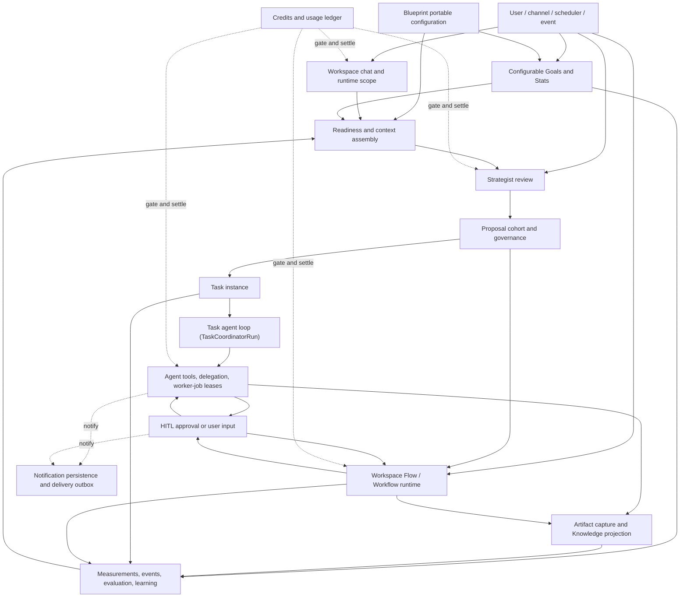

# Manor Workspace Architecture

This document describes the Workspace runtime and its verified boundaries. It
is a navigation and change-impact contract for engineers and coding agents.
The invariants below apply to the code paths named in each node and their
listed tests; they are not a claim that every legacy entrypoint has identical
coverage. When prose and code disagree, inspect the listed code entries and
update this document with the code change or mark the gap explicitly.

## Evidence status

- **Implemented** means a named code path exists and has a focused regression
  test. It does not mean every caller is covered.
- **Projection** means a runtime value is portable or user-visible only after
  the named projection/installer path runs; a filesystem path, model claim, or
  raw database row alone is not evidence.
- **Gap** means the repository currently has no complete implementation proof.
  A gap is recorded here so a future change cannot treat the statement as an
  existing guarantee.

## System view



The solid arrows are business-state transitions. The dotted credit edges are
cross-cutting controls. Governance is also cross-cutting: Proposal approval,
Task agent-loop tool approval, Workflow action approval, and direct chat tool approval
share policy concepts but have different execution origins and resume paths.

## End-to-end operating loop

```mermaid
sequenceDiagram
    participant Trigger as User/Schedule/Event
    participant Runtime as Workspace Runtime
    participant Strategist
    participant Governance
    participant Task
    participant Loop as Task agent loop
    participant Worker as Agents and tools
    participant Knowledge
    participant Evaluation

    Trigger->>Runtime: workspace-scoped trigger
    Runtime->>Runtime: resolve membership, subscriptions, tools, readiness
    Runtime->>Strategist: review with goals, evidence, Knowledge, history
    Strategist->>Governance: Proposal with Task/workflow/change items
    Governance-->>Strategist: allow / needs_human / deny
    Governance->>Task: approved ProposedTask becomes executable Task
    Task->>Loop: start intent (outbox) claims one TaskCoordinatorRun wake
    Loop->>Worker: own tool calls or delegate_to_agent
    Worker-->>Loop: tool receipts / child results / approval or input park
    Loop->>Loop: update_task_plan, checkpoint every round, self-verify
    Loop->>Knowledge: complete_task with host-verified deliverables
    Knowledge-->>Task: Document id, viewer URL, canonical artifact reference
    Task->>Evaluation: terminal status and execution evidence
    Evaluation-->>Strategist: goal impact, outcomes, learning, next review context
```

This is the autonomous Task path. A Workflow can be launched directly by the
user, scheduler, event, or Proposal; it does not become a Task. Workflow
nodes execute inside `WorkflowRun`, while a Workspace Task executes as one
durable agent loop on its `TaskCoordinatorRun`. `ExecutionPlan`/`ExecutionStep`
rows and the Dispatcher now carry only external worker jobs (local CLI actions,
Claude Code/remote coding, local worker), which have no Task.

## State ownership map

| State | Owner | Scope | Portable in Workspace Blueprint |
| --- | --- | --- | --- |
| Workspace shell and operating model | `Workspace` | Workspace | Yes, safe configuration only |
| Goal and Stat configuration | `Goal` (stable `goal_key`, target, source/cadence, Stat binding) and `WorkspaceStat` (collector definition/revision) | Workspace; a Goal may also be entity-scoped | Yes for definitions, safe baseline and portable source configuration; no for observations, measurements, current values, pace, task links, or schedule runs |
| Goal and Stat runtime evidence | `GoalMeasurement`, `WorkspaceStatObservation`, `GoalTaskLink`, goal/stat current value and pace | Workspace/runtime | No |
| Agent deployment | `AgentSubscription` | Workspace | Yes, by service key and agent slug |
| Resident maintenance creation | `ResidentCreateGrant`, `ResidentMaintenanceDraft`, encrypted credentials and proof-bound UI nonce | Private resident browser/conversation runtime | No; grants, drafts, confirmed payload, submission keys and receipts never transfer |
| Resident Webchat verification | `WebchatResidentBinding`, CredentialService encrypted material, private Channel target | Workspace/channel/contact/conversation/browser runtime | No; target account identity, proof/state digests, PKCE verifier, grants, subject and private-history tombstones are not Blueprint-portable |
| Connected integration account tool discovery | `MCPAccountToolCatalog`, projected through the actor-scoped runtime integration registry | User/entity account runtime | No; contains credential-free schemas only and is valid only for the saved endpoint, bounded cache age, and matching actor account-registry snapshot |
| Strategist behavior constraints | `operating_model.strategist` | Workspace | Yes |
| Proposal cohort and decisions | Proposal records, proposed `Task` rows | Runtime | No |
| Task | `Task` | Workspace or entity | No |
| Task run | `TaskCoordinatorRun` (engine `agent_loop`: checkpoint, claim, wake generation), delegated `TaskAgentChildRun` | Task/runtime | No |
| Worker-job Plan and Step | `ExecutionPlan`, `ExecutionStep` (external worker jobs only; no Task) | Runtime | No |
| Worker lease | `WorkLease` | Step/runtime | No |
| Workflow definition | `WorkflowDefinition` | Workspace or entity | Yes when Workspace-owned/bound |
| Workflow deployment | `WorkflowBinding` | Workspace | Yes |
| Workflow execution and project state | `WorkflowRun`, `WorkflowProject` | Runtime | No |
| Workflow action grant | `WorkflowActionGrant` | Runtime/Workspace | No |
| Automation definition | `ScheduledJob`, binding trigger config | Workspace | Yes when Workspace-scoped |
| Automation runs | `ScheduledJobRun` | Runtime | No |
| Artifact file | Entity filesystem | Workspace path | No as runtime output |
| Artifact index | `Document` plus provenance | Workspace/Knowledge | Starter content is portable; runtime artifacts are user-visible only after projection |
| Approval request/grant | HITL/governance records | Runtime/policy | Portable policy rules yes; decisions, tokens, and live unattended-run consent no |
| Credits | grants, reservations, transactions, usage | Entity/runtime | No |
| Twilio Voice call runtime | `TwilioVoiceCallSession` | User/Entity and optional Workspace runtime | No; call sessions, provider identifiers, stream-token digests, and usage state are not Blueprint-portable |
| Notification and external delivery intent | `Notification`, `NotificationOutboxEvent`, `NotificationDelivery` | Entity/Workspace/runtime | No |
| Task categories/SLA/escalation | task policy rows | Entity | No; configure through entity-level administration, never Workspace Blueprint |

## Node catalog

Each node uses the same fields so an impact review can be performed without
guessing ownership.

### WS-01: Create, install, and configure Workspace

The App may own independent `app_view.entries` addressed by `action:<id>`.
Each entry references an actor-visible Agent, Workflow binding, or Automation
through typed `targets`; Agent instructions use `prompts`. No Service is
required and several commands can reference the same Agent. Config and Chat
use the reviewed `app_view.update` draft/apply path. Removing an entry cleans
its display settings only; runner resources remain. Legacy derived entries,
including namespaced Service keys, remain compatible. Blueprint export still
omits this local-ID App config. See `tests/test_workspace_app_direct_entries.py`.

Purpose: materialize the Workspace shell and its declared operating parts.

- Code entry: `packages/core/services/entity_service.py`,
  `packages/core/services/workspace_setup_service.py`,
  `packages/core/services/workspace_draft_service.py`,
  `packages/core/blueprints/installer.py`, and the Workspace/Blueprint API
  routers, including `apps/api/routers/workspaces.py` for deployment-local
  Webchat page configuration.
- State: `Workspace`, memberships, subscriptions, Goal/Stat definitions and
  collection schedules, Knowledge folders, workflow definitions/bindings,
  scheduled jobs, policy, install provenance, and explicit public-page
  references stored on a Workspace Channel binding.
- Success invariant: a fresh Workspace resolves all declared portable parts to
  new local identities, records install-time todo results separately from every
  required live setup declaration, and never reuses source row IDs or
  credentials. Required external Blueprint channels select an accessible
  user-owned credential source before Workspace mutation and create only the
  Workspace routing binding inside the install transaction. Conversational
  creation offers only actor-ready integrations for new Agent
  MCP bindings and requires an existing usable connection for external channel
  selections; lint and finalize recheck this. Blueprint dependency declarations
  retain their separate install-time setup contract. A dependency that
  passed during install remains re-checkable
  after later disablement. Required MCP binding fields remain live readiness
  checks; optional MCP requirements may produce setup guidance but never block
  normal work.
  WhatsApp Business Connect is account-only: Embedded Signup creates one
  user-owned, provisioned `Integration` and one source-linked, unbound
  `ChannelConfig`. It never selects an Agent or creates a `Channel`; the
  existing Agent Binding service separately writes the exact
  AgentSubscription/Workspace route.
  Authenticated public Webchat creation persists its actor on the configuration
  and binding for public audio billing. Reusing an existing
  configuration preserves its owner; missing historical ownership fails closed
  at public audio admission and is never inferred from a visitor or member.
- Default governance: system-authored drafts and Blueprint installation/upgrade
  project source rules and effective policy together through
  `governance/defaults.py`. Author hard blocks become human approval gates;
  default risk ceilings become review, not prohibition. Safe reviews every
  action, including calls without action/capability identifiers. Mixed template
  auto-grants also become review rules so resource/glob overlap and later source
  rebuilds cannot silently bypass approval. Factory context sees this projection
  before capability planning. Server-owned exact-rule fingerprints preserve
  typed, user-confirmed draft bans; model output cannot mint those receipts.
  Existing live operator bans, explicit Blueprint hard-block opt-in, ACLs,
  readiness, lifecycle, budgets and credits retain their separate gates. This
  projection is not a bulk migration of historical Workspace policy.
- Failure boundary: partial setup must not be reported runnable. Installation
  either fails transactionally or returns explicit blocking todos/readiness.
  Draft readiness validates the same effective Agent tool bindings that
  provisioning materializes, including business-capability expansion. Generated
  drafts with only invalid Agent bindings receive one scoped, bounded Architect
  repair before Workspace creation, then must pass fresh readiness checks.
  Repair preserves valid bindings and existing Agent settings, uses the normal
  actor, capacity, credit and tool-authorization boundaries, and cannot change
  other services, user choices or frozen Blueprint content. Concurrent edits
  abort stale repair; a concurrent successful finalize returns its existing
  Workspace identity. Failed repair leaves an editable draft. The creation
  stream exposes repair progress and keeps quiet matching phases connected.
  New `ws_propose_rule` hard blocks require an explicit
  `enforcement_scope=all_matching_actions` declaration plus the existing user
  quote check. Content/time conditions that action patterns cannot express
  remain guidance; they must not silently become unconditional action bans.
  This declaration does not prove natural-language intent or migrate old rules.

- Initial autonomous review: `services/workspace_initial_review.py` stages one
  `workspace-initial-review:v1` occurrence on the existing `sr:` ScheduledJob
  inside live installation/provisioning, then publishes its normal Strategist
  child after commit. An incomplete setup with allowlisted human input can be
  assessed immediately; WS-04 still discards business Tasks at persistence.
  Ready Blueprints with an explicit `on_ready_job_id` keep their startup owner.
  Simulation, manual mode, and blocked setup without allowlisted input retain their
  existing paths. The occurrence remains an EVENT review and gains no scheduled
  unattended-run approval authority. Its initial readiness-count snapshot
  prevents a duplicate first count-change trigger; later changes still trigger.
  Existing scheduler recovery owns unacknowledged handoffs (the prepared-run
  sweep has a five-minute age threshold), execution claims, and terminal replay
  suppression. Ambiguous admitted worker loss retains the scheduler's failure
  semantics. Run references and snapshots are runtime-only, never Blueprint
  configuration; there is no historical Workspace backfill.


### WS-02: Resolve runtime scope and Workspace chat

Purpose: turn a conversation, Task thread, channel message, or worker turn into
one bounded Workspace runtime envelope.

Persisted browser Chat (personal, Agent DM and Workspace) always owns a durable
RuntimeRun, regardless of legacy inline execution or local/external Sandbox
placement. The question, checkpoint and wait state commit together; generic
Runtime outbox maintenance owns lease recovery and input expiry in every mode.
Non-resumable entrypoints omit `request_input` from schemas, discovery and tool
scope unless their host supplies an explicit end-turn bridge/custom handler.
Capability refresh preserves host restrictions; registration is not proof of
continuation support. This is runtime behavior, not Blueprint configuration.

Workspace Chat buffers final candidates until its response contract accepts
them; live host/tool events remain streamable. `execution_summary` references
Task IDs, origin scope and current evidence revisions, not model-authored
statuses. The server reads Task/Plan/claim/lease/HITL/outbox evidence and renders
the status. A same-turn claim needs an append-only WorkspaceEvent committed with
the originating action; old or scheduled work is `existing_record`. Reply
repair uses the same Agent loop and never restores a broader tool allowlist.
Tool-enabled ordinary, Agent DM and Workspace Chat share a current-turn outcome
contract. Discovery, availability and execution observations remain distinct;
an old Task blocker or disconnected inferred provider cannot prove current
research impossible. Missing current evidence returns feedback to the same loop.
The evidence survives only the host checkpoint for that run, not a later turn.
Operation claims bind current call IDs to the normalized tool/composite action;
an unrelated read cannot substantiate creation or capability failure. Workspace
inventory searches retain a separate stage, and an unsupported category returns
the common diagnostic contract instead of an empty inventory. A successful empty
read supports a scoped partial result, not a capability blocker.
The host collects bounded operation facts independently of child prose. Skill
returns carry these in-process facts into the parent, with call IDs qualified
by their invocation path; serialized tool JSON cannot manufacture them. Both
pending-call checkpoints and nested transcript checkpoints retain the facts.
Skill invocation completion is a delegation event, not delivery evidence.
Overall partial may combine completed and not-attempted/blocked operations;
overall completed cannot contain unfinished operation claims. Reply-only
inconsistency uses the no-tool revision lane, without replaying successful work.
On validation exhaustion, keep the terminal error and diagnostic facts, and
render only a host-generated bounded explanation, never the rejected candidate.
Failed Chat turns retain the shared process blocks and frozen whole-turn clock
in storage, SSE and history. Preliminary text and interactive generated surfaces
are excluded from that failure projection; individual tool outcomes stay intact.
The `answer` branch is model prose, not a semantic guarantee of truth;
Workflow/media-job summaries are not yet part of
this Task receipt contract. No response candidate grants approval or completes
a Task. Receipt/event data is runtime-only and must not enter Blueprints.

Semantic capability discovery compares scoped native tools, Skills and providers
in one bounded, paged catalog. Shared words are recall hints, never relevance or
substitutability proof. Assessment failure is explicit and unassessed; MCP provider
selection is a candidate route, not proof that its account is required. Skills
retain dependency metadata; current authorization remains authoritative at call.
Interactive Chat surfaces keep their authorized tool and Skill scope available;
the model selects actions from the current turn and discovery results. Request
keywords do not force a Skill, hide a tool, or inject a remembered tool path.
Explicit mode, selected Skill, attachment type, and approved continuation remain
structured inputs. They do not replace execution authorization.
`manor(action='search')` is a compatibility alias of that same registered Runtime
discovery handler, including account/schema loaders and next-round schema loading.
Composite-only Manor actions are descriptors in the same scoped catalog, not a
second keyword search. Matcher failure retains its bounded descriptor page for
the parent Agent to inspect. Discovery and outcome evidence remain runtime-only;
approval, credit, lifecycle and Blueprint configuration boundaries are unchanged.


Successful media generation is an ordinary tool observation, not an implicit
Agent-loop terminator. Normal, forced and resumed calls return to the same
model loop; only explicit host terminal policies retain early-stop semantics.
The model can continue assembly and inspection before the caller's final
response/output contract runs. Pending media jobs retain their existing host
wait path. A provider job completing does not prove the requested edit or
delivery was completed; its public warnings, omitted features and
post-production intent survive the wait receipt. Prompt-Skill handoffs preserve
the child loop outcome separately from bounded, redacted tool observations.
Those observations are evidence for the parent model, not authorization,
no-effect proof or semantic acceptance. Existing HITL, unknown-effect,
credit/round limits, exact render approval and durable artifact gates remain
authoritative; no extra permissions, database state or Blueprint fields are
introduced. Model-authored completion claims still require actual artifact
inspection and must not be confused with host-verified properties.

Ordinary and Workspace Chat share foreground stream completion: an accepted,
Conversation/Message-scoped `stream_end` ends the live indicator and freezes the
process clock without waiting for HTTP EOF. Already accepted text may finish its
local incremental display; its final block snapshot cannot bypass the display
queue. Failure, cancellation and HITL release the queue immediately. Same-chunk
terminal metadata is retained; delayed nonterminal frames cannot reopen the
turn. A stale nonterminal runtime status cannot start recovery after this event.
This ends only the foreground turn, not a pending HITL or background Task.

All AI Chat entry surfaces (ordinary, Workspace, group @Agent, FloatingChat and
Agent DM and AI Edit) use the shared assistant process presentation. A completed pure-prose
turn retains its host lifecycle and available runtime clock with no fabricated
tool steps. Legacy prose with no clock retains completion only. Group runs own
public tool-event metadata separately from approval checkpoints: only tool names,
statuses and timestamps reach room members; raw arguments/results and unapproved
reply candidates remain private. Pending/running/approval/failure/stopped states
use the same process card, with existing review controls and audience checks.

AI Edit adds actual editor read, patch-generation, preview-apply and verification
events to that same process card without exposing patch payloads. Its terminal
event waits for the editor adapter to settle; neither reader waits for HTTP EOF.
Preview completion does not imply Accept or persistence. The editor owns Accept,
Discard, rollback and target identity; native persisted-file reloads report their
actual saved state separately. Stopped or failed previews never become successful
editor steps, and temporary conversation cleanup retains its owner scope.

History compaction treats the summary length target as advisory. A complete,
validated checkpoint may exceed it only when its actual packed request,
including tools, ledger, archive notes and reserved output, fits the model
window; intermediate summaries also leave the next batch full output headroom.
Invalid, truncated or oversized checkpoints allow one shorter regeneration from
the same records and previous valid checkpoint. Every completed attempt retains
the configured model/BYOK route and usage. Failed recovery keeps original history
only when that history and reserved output still fit; otherwise it fails closed.
This WS-02 recovery policy changes no approval, lifecycle or Blueprint state.

History compaction checks cancellation between preparation stages and during
summary model waits. A cancelled turn drains the pending model request, retains
completed usage, and publishes the interrupted Message and cancelled stream
terminal without saving another context checkpoint. Archive and checkpoint
lease/version guards remain authoritative; cancellation never bypasses them.
The browser retains the scoped cancelled terminal even if an older runtime
status arrives later in the same stream chunk.

Chat Stop immediately detaches local output, settles the process card and
restores the composer. It has no stopping label or manual cancellation retry
state. The browser retains an in-flight admission receipt to learn the exact
run ID, retries failed cancellation requests independently, and confirms the
terminal run before submitting another turn in that session. Cancellation
updates are fenced by the original generation so they cannot overwrite a newer
turn. Context discovery and deferred Workspace recommendation waits must also
observe cancellation, drain their pending work and persist an interrupted
Message before the worker publishes its terminal event.

Process presentation also uses exact message ownership, never a Workspace-wide
streaming flag on historical replies. Each process carries the server's turn
`started_at_ms`, pinned `ended_at_ms`, and `lifecycle_status`, separately from
its tool-attempt aggregate. Long and nested tools retain the start anchor across
stream snapshots and browser remounts. Runtime completion, failure, cancellation,
and waiting determine the lifecycle; final model prose does not. Completed
replies retain failed/unverified attempts in their details without reopening
the clock or claiming an unrelated success recovered those effects. Legacy
messages without lifecycle evidence retain conservative attempt summaries.
These are Message runtime fields, not Task settlement or Blueprint state;
authorization, credits, artifact verification, and HITL continuation are unchanged.

New Workspace custom Agents receive explicit protected file-read and file-write
bindings together at provisioning. These are creation defaults, not runtime
grants: removing a saved binding continues to revoke it, and an inactive tool
definition is excluded from the resolved Agent scope. Historical file workers
with incomplete bindings need an explicit scoped configuration change.

The authenticated user's saved `User.locale` also supplies the default language
for generated answers, progress, titles, summaries, and artifact text. Runtime
prompt assembly, one-shot generation, and Task agent-loop calls share that rule;
nested Agent work inherits its parent turn's language. A later turn or resume
reads the current preference. Explicit output/recipient language and external
customer/channel audiences retain their own language contract; machine keys,
schemas, code, and quotations remain intact. This is user preference and
run-local context, not Blueprint configuration or authority to rewrite history.

Skill invocation routes only the current operation before attaching structured
parameters and runtime/dependency artifact references. Those references remain
available to the Skill but are not platform-action intent. Video Edit local
composition/export, like internal Knowledge document creation, is not an
external publishing action merely because it mentions a social platform.
Actual publishing still uses the platform route and existing tool authorization,
approval and credit gates. A routing skip is not a runtime readiness probe and
must not be presented as a missing renderer or missing account. This is run-local
routing behavior; it changes no saved Agent binding or Blueprint configuration.

An explicit Skill `type=runtime_guidance` selects the existing prompt/tool loop,
even when its bundled directory includes tool-owned renderer helpers. Those
helpers are not standalone Sandbox Skill entry points. Explicit `sandbox` and
`prompt` types retain their execution paths; legacy file-based detection applies
only when none of these types is declared. `execution_mode=instructions_only`
remains a separate opt-in and tool authorization/review gates remain unchanged.

Repository tool registrations may also name a bundled instruction Skill (Video
Edit binds `video-edit`). The shared Agent loop loads that same-image text and
its content hash into a single runtime-owned system section before the model
authors calls to an exposed tool. This is documentation in the current loop,
not `invoke_skill`, another model loop, a DB Skill upgrade or a capability grant.
Installed/custom Skills remain untouched. Compaction retains the section;
transcript resumes rebuild it and pending-call checkpoints revalidate its exact
current content. An unobserved, changed or missing guide rejects execution
before effects through the shared typed preflight/tool-error contract. The model
chooses its own corrected call; exact approved continuations still obey their
existing follow-up restrictions. Only immutable public bundle text is cached
process-wide; consumption and transcript state are local to each run. Guidance
does not change Task status, approval, credits, artifact projection or Blueprint
configuration.

Workspace operation, automation and Ledger first-party tool overlays are
additive: they preserve the main Chat master's existing `None` registry scope
instead of converting it into an allowlist of only the overlay tools. Task
Hosts first receive a concrete scope and retain that scope; specialist Agent
bindings and all per-tool authorization checks remain enforced.

An eligible built-in Ledger Skill whose contract is installed in the Workspace
keeps a prompt-catalog slot ahead of unrelated ordinary built-ins, after required
and explicit Agent-bound Skills. This ordering uses verified contract metadata,
not names or user-message keywords; the catalog budget, surface/tool checks and
write authorization still apply. Canonical built-in invocation recognizes a
legacy Agent binding only through its exact persisted source Skill identity.

Video Edit's Sandbox heartbeat refreshes an existing available session's idle
timestamp and returns its current expiry; it never runs project code, creates a
session, or grants capacity. Missing/unavailable sessions retain 404/409 behavior.
Idle cleanup rechecks each candidate's identity, state and timestamp after
earlier asynchronous cleanup, so a newly renewed or busy session is not pruned.

Video Edit start, status/recovery and sync expose the same authoring contract.
Source writes remain durable drafts: `source_updated` does not mean that the
project passed validation. Structured file/rule diagnostics guide the same Agent
loop before strict review; the runtime does not select a repair strategy or a
replacement template. Neither diagnostics nor a valid source contract grant render approval; the exact
reviewed source hash and normal artifact/Knowledge projection remain required.

All tool execution failures use one model-facing `tool_error` projection:
`status`, `tool`, `error` code, `message`, and structured `details`. The shared
decoder recognizes handler, MCP, exception, command and input-validation errors;
unknown domain statuses do not imply failure. Repeated results and context
compaction retain structured diagnostics with explicit omissions, not just a
preview. Original receipts, host-only proof and human gates remain separate.
The common input validator rejects malformed JSON/non-object/schema violations
before approval or effects, including host controls outside ToolPool. Its
diagnostics expose field paths, schema expectations and parse coordinates, not
secret input values. The runtime never repairs arguments or guesses an action:
normal, forced and resumed loops return evidence for the model to correct the
next call within existing permissions and budgets. Uncertain prior writes still
require reconciliation. Input, Task completion, artifact and draft validators
use the common diagnostic constructor; they keep exact causes and constraints,
not executable repair recipes. Provider `recommended_next_calls` are observations,
never automatically scheduled calls or authorization to load MCP schemas.
Skill result receipts retain configured primary delivery and read-back validation,
but a failed save or verification returns its primary/save/read evidence instead
of automatically overwriting a file. Successful source writes with invalid
contracts retain successful status and structured violations during compaction.
Host media waits, exact approved continuations and durable effect reconciliation
remain control flows, not model-selected repair. Read-only alternate-path
permission requires a host-held result type, never a serialized `retry_policy`.
An exact stored Chrome approval continuation restores its declared confirmation
receipt and action signature for the run guard; incomplete policy stays blocked.
Restoring this evidence never replaces the durable HITL claim or grants approval.
An approved basic Chrome action executes the saved call
once, then restores the canonical Chrome task tools for fresh observation,
drafting and tab finalization. Later calls recheck current permissions and
policy; the consumed token never authorizes another action or final submission.
Non-basic ordinary/representational confirmations execute only their exact call
without restoring the full browser surface.
Server-bound ref continuations persist only the closed basic, ordinary-action,
and representational-action classifications. Missing or changed proof, locator,
or argument hash fails before policy evaluation; an invalid continuation cannot
fall through to a broader ordinary-action allow rule. The approval card projects
the observed target label without changing the frozen call or its hash.
Pydantic diagnostics exclude input values. When `complete_task` verifies a
deliverable, only `artifact_busy` (the file is being written) may fall back to
the run's receipt; other verification failures keep their original code and
cause and return to the same Task agent loop as a preflight refusal.
These are run-local contracts, not Blueprint state,
extra grants, lifecycle changes or changes to credit accounting.

- Code entry: `packages/core/services/workspace_runtime.py`,
  `packages/core/ai/runtime/tool_visibility.py`,
  `packages/core/services/task_session.py`,
  `packages/core/services/assistant_blocks.py`,
  `packages/core/services/response_surfaces.py`,
  `packages/core/ai/mcp/email.py`,
  `packages/core/services/channels/email_adapter.py`,
  `packages/core/services/channel_gateway.py`,
  `packages/core/services/runtime_chat_context.py`,
  `apps/api/chat_voice.py`, `packages/core/services/voice/browser.py`,
  `apps/api/routers/channels/voice_stream.py`,
  `packages/core/services/voice/binding.py`,
  `packages/core/services/voice/session.py`,
  `packages/core/services/voice/work_queue.py`,
  `packages/core/services/voice/work_router.py`,
  `packages/core/workspace_chat/context.py`,
  `packages/core/workspace_chat/service.py`, `apps/api/routers/workspace_chat.py`,
  `apps/api/routers/chat.py`, and `apps/api/routers/public_chat.py`.
- State: `Conversation`, `Message`, `workspace_id`, `task_id`, runtime/tool
  profiles, subscription-bound Agents, open pending actions, task blockers,
  canonical user feedback subjects, Webchat visitor session/contact scope, and
  the runtime projection of explicitly published Workspace content references.
- Group chat is a separate, non-Workspace conversation entry in
  `apps/api/routers/chat_rooms.py` and
  `packages/core/services/room_agent_runtime.py`. A selected `@Agent` records
  one `ChatRoomAgentRun` per source message and exact room binding before
  execution. Every group turn uses the ordinary Chat agent loop and its
  minimal shared prompt sections under `PUBLIC_CUSTOMER_CHAT`, but builds the
  prompt without personal, Entity, Workspace, or Agent-file context. Default
  Manor AI has no Workspace scope. Only text visible to every active member enters
  the model. Every active group member may request a public web search using
  only a phrase in their latest message. The model decides whether to search;
  its query is limited to that phrase, and membership, binding, and audience are rechecked before
  external I/O. Search does not inherit room history, attachments, or private
  Agent tools. Explicit public-URL reads are limited to URLs in the current
  member's request. With the
  owner-controlled file setting off, no file tools are available. When enabled,
  the only room file tools are room-scoped file listing,
  bounded reading, and group-file generation/management, regardless of request
  keywords. The model selects whether to call them using the current request
  and visible conversation context; the server still authorizes each exact
  call. No generic private
  Knowledge, MCP, Workspace, or generic sandbox tool is inherited. A claimed
  Office-file request always hands off its platform-owned file Skill's exact
  run-bound sandbox; only that sandbox's file workflow is available, and its
  final bytes enter the group folder through the claimed receipt. The server
  stages the latest request, visible quoted/history context, current and quoted
  attachments, explicitly read room files, and actual public tool results as
  bounded, hash-labelled original materials. Model drafts remain drafts, not
  evidence. Explicit current-request URLs are fetched before handoff even if
  the model skipped web_fetch; unavailable or oversized references fail closed, and room-file
  hashes are rechecked before save_result. The run
  bills the room owner's Entity, never an external member's Entity, and the
  existing credit gate precedes provider I/O. A unique source/binding key
  prevents duplicate work. API responses only enqueue the durable run to a
  dedicated `room-agents` worker queue; a bounded control-plane sweep redrives
  overdue pending runs using `last_enqueued_at`. The worker claims `pending`
  under a row lock before provider/tool I/O. A hard-killed `running` run is
  interrupted after the worker timeout, never replayed, because a file side
  effect may already have occurred. The room audience, sender, binding, Agent,
  subscription, Workspace, and binding creator's authority are rechecked
  before execution and publication; revoked or changed scope interrupts the
  result. Agent sender name/avatar and source reply are persisted as message
  snapshots, so removing a binding cannot rewrite history. These room/run
  records are runtime state and never Blueprint configuration.
  A member may leave an active group without deleting its history; the owner
  must transfer custody or close the group first. Sender-initiated retraction
  keeps the original row and an audit receipt but returns only a tombstone to
  members, excludes its text from search and unread counts, and invalidates
  pending Agent work. Runtime history and source admission exclude retracted
  messages. A shared group file survives message retraction until separately
  removed through the group-file permission path.
  A Workspace Agent's group reply uses the same `external_message.send`
  governance decision as a Workspace Channel, scoped to the room ID. A hard
  block prevents model execution. A human-approval rule permits a bounded
  group-only run but freezes its final text on `ChatRoomAgentRun` instead of
  publishing it. The draft is shown only to an active room owner/admin who
  also has Workspace `approve_external_publish` authority; no group message
  or draft is posted to Workspace Chat for a non-member to see. A decision
  binds the exact draft digest. Approval resumes publication without a second
  model call and rechecks room audience, Agent binding, Workspace policy,
  and the approver's dual authority; rejection or revoked scope publishes
  nothing. This is room runtime state, not a Blueprint Channel binding.
  The group owner's revisioned, default-off AI file setting is a capability
  ceiling, not a personal or Workspace grant. Every active member can initiate
  a file-capable turn once the owner enables it. Legacy enabled rooms retain per-call human
  approval until their owner explicitly opts in to direct group-file actions;
  after opt-in, new exact-argument mutations use a durable single-use claim
  without per-call review. The run, claim, requester, execution actor, Agent
  binding, audience fingerprint, and setting revision are rechecked before
  side effects and before publication. Read tools accept only an attachment
  ID visible in that room, not a path, URL, or arbitrary Document ID.
  Generated Documents are written to a private Knowledge folder named
  `Group chat files/<group name>-<room id>` and published to that room only
  through a pinned-size/hash attachment after a succeeded claim receipt.
  Folder identity remains stable after room rename. Existing personal or
  Workspace Knowledge never becomes readable through a group file tool.
  Member-uploaded and Knowledge-copied group files are limited to 1 GiB each
  and 10 GiB of retained room copies per room. Copies above 100 MiB use
  immutable 4 MiB database chunks with a pinned size/hash and parent-delete
  cascade; existing inline copies remain readable. Batch downloads admit up to
  100 visible files totaling 5 GiB, prepare ZIP64 archives on bounded private
  temporary disk, then stream after revalidating current room authority.
  Exact-selection download tickets expire within ten minutes and never
  outlive the initiating credential. Those copies count toward the
  owning Entity's Knowledge storage plan: a personal room uses its owner's
  primary Entity, and an Entity room uses its owning Entity. The copied bytes
  count separately from a source Knowledge Document; generated group Documents
  count through Knowledge only once. Closed rooms and retained removed files
  continue consuming storage.
  An external member's output still lands only in the group owner's custodian
  folder and is billed to the room owner's Entity; membership does not grant
  general access to that Entity's filesystem.
  Media-model generation is not in the room tool allowlist until external
  egress and billing are authorized.
  A group owner or admin creates a pending exact-email invitation, never a
  direct membership. A verified active Manor account receives an in-app
  invitation; an unknown or unverified address receives a branded email when
  SMTP delivery is available, with the link returned for manual delivery if it
  is not. Signup alone never joins the room: explicit acceptance rechecks the
  current email proof and room state. An owner/admin may revoke a pending
  invitation; reissuing revokes its old link. Rejoining resets the member role
  and message visibility to the new join time. Per-member read cursors count
  only other senders' messages since that join and advance only through a
  message displayed in the open room. These room, invitation, notification,
  and read-cursor records are runtime state. Group membership never grants
  Entity or Workspace membership.
- Restriction changes inspect source rule keys/types/patterns and live policy
  through read-only `operation.get_current`; rules search retains those sources
  beside their inferred effects. Validation, review and apply use one effective
  policy calculation. Single-rule edits preserve unrelated live policy entries;
  same-value updates cannot use unrelated policy drift to pass as changes.
  Explicit full-list `rules.replace` retains its rebuilding contract. Removal
  of a hard block does not remove remaining human approval requirements.
  Workspace Chat integration changes use the reviewed operation draft:
  `integration.remove` disables a provider locally, while an added MCP binding
  or restored provider must pass actor connection readiness at review and apply.
  Integration payload shapes are registered beside their patch handlers and
  projected to tool schemas, Runtime input validation and operation guides.
  Guides include current operation parameter constraints and validated Manor
  action identities. `update_workspace` rejects operating-model,
  budget and heartbeat fields so metadata editing cannot bypass reviewed drafts.
  Draft edits and decisions lock and reload the Workspace and draft before
  mutation. Reviews bind the exact draft contents to a versioned card identity;
  changed or legacy unversioned approvals require a fresh review. Concurrent
  edits cannot rewrite a terminal draft's receipt. Knowledge collection writers
  advance the same Workspace operation revision when configuration changes,
  so an older operation draft conflicts instead of restoring its old snapshot.
  Runtime repair likewise advances that revision when it changes configuration
  or Agent deployments; an unchanged repair keeps pending reviews valid.
  Account readiness reuses one actor-scoped registry within each check and
  reloads on the next check; it never caches authorization across requests.
- Direct upload reads use exact server-persisted user `Message.attachments`
  references in the current active Conversation. `ai_file_permissions` checks
  current actor, Workspace visibility, canonical non-symlink identity and any
  Knowledge projection (including trash/restrictions) before `read_file` or
  source conversion reads bytes. Upload directories stay hidden and read-only;
  text mentioning a path or a foreign Conversation is never a grant. Conversion
  outputs still enter WS-10 through the ordinary approval/projection boundary.
  Process steps retain failed attempts; a successful retry of the same source
  digest, output name/type and destination can mark that failure recovered.
  Unrelated successful tools and final prose cannot clear unresolved errors.
- Success invariant: the turn sees only the target entity/Workspace/Task,
  correct service Agents and tools, plus unresolved HITL relevant to that
  conversation. Manor AI in Workspace Chat inherits the complete ordinary
  owner-Chat tool and capability baseline before Workspace-specific capabilities
  are added; a custom or service Agent remains limited to its own bindings.
  Runtime defaults, Agent bindings, and Workspace/Task overlays
  resolve to one run-local effective tool scope consumed by prompt assembly,
  `search_tools`, and the execution gate. Search may progressively load a
  schema from that scope but cannot add a first-party permission; execution
  still revalidates the current durable or contextual binding. Tool discovery
  distinguishes an explicit provider from one inferred for a semantic
  capability query. An unavailable inferred provider does not discard otherwise
  callable native/alternative matches. No-match errors use the shared
  `tool_error` with provider-selection provenance and available alternatives;
  they do not establish that the whole capability is unavailable or terminate
  the parent loop. Explicit provider queries remain constrained. Discovery
  neither executes an alternative nor adds authority: the model chooses its
  next permitted action from these facts. Provider-level
  MCP wildcard/action scope remains semantic run-local authority in the Runtime
  envelope; it is not flattened into old catalog names and is not persisted in
  message metadata for a later turn to replay. An `interactive`
  Task thread always resolves and binds its
  sole Host Agent from the Task assignment or owner subscription before Skill,
  prompt, tool, billing, and message-author resolution; request Agent IDs and
  mentions cannot replace that Host. Foreground comments on a `general` Task
  use its exact persisted Workspace Task thread without rewriting the Task's
  original execution conversation. First-party Chat resumes on that thread
  retain the Task-comment surface/profile; background and external surfaces
  never acquire it from a thread reference or message metadata. Task-level
  rules still gate every comment tool call. A completed Plan has one feedback subject
  per user even when its receipt is projected into multiple conversations;
  taskless completed Plans remain rateable through a Plan subject. Deleting the
  owning Task retires its completion message markers, canonical feedback, and
  reviewer evidence in the same transaction, so an orphan projection cannot be
  rated afterward. Current feedback writers require an explicit typed target,
  canonical target ID, and server mutation revision; historical completion
  headlines and per-message metadata maps are accepted only by the upgrade
  migration, never by runtime classification or dual-write paths. The canonical
  completion producer takes the same subject
  lock and revalidates completed Plan/Task lineage before posting, so a delayed
  worker cannot recreate that projection after deletion. A supplied
  Conversation identity must
  still resolve in its entity scope and never downgrades to an unscoped turn.
  Internal Chat may persist a validated response surface in the assistant
  message block stream. Registered templates and generated HTML share one
  versioned contract, one isolated renderer, a complete text fallback, and a
  bounded action bridge that returns user input through the existing Chat turn;
  the embedded document never receives Manor API, credential, storage, or
  network access. Generated surfaces are declarative HTML/CSS only; JavaScript
  behavior is available exclusively through reviewed, registered templates, so
  model-generated code cannot widen the bridge or browser capability boundary.
  User-triggered Agent provisioning carries the authenticated actor into Skill
  resolution; exact IDs and legacy slugs bind only Skills that actor may read,
  while trusted Blueprint/setup orchestration remains an explicit internal path.
  Runtime Skill discovery and invocation share the same tenant, active-state,
  user-resource, Agent-binding, and installed Workspace Ledger eligibility
  boundary; hiding a Skill from the prompt catalog is never the execution gate.
  Workspace Chat uses the repository-owned `workspace-operations` instruction
  router and seven operation guides. Common intents preload only the relevant
  instructions before actor/Workspace context; ambiguous requests can invoke a
  guide through the existing instructions-only Skill path. Shared caches hold
  source text and tool-contract fingerprints, never Workspace state or grants.
  Guide indices recheck the current tool scope. Built-in reseeding revisions
  reflect source and dependent tool-contract changes. Runtime message metadata
  records loaded guide fingerprints for diagnostics, not authorization.
  WhatsApp Business inbound resolves `metadata.phone_number_id` to one active
  owner-matched `ChannelConfig`, one active `Channel`, and the exact active
  AgentSubscription/Workspace saved by Agent Binding. It never uses a
  `ChannelContact.agent_subscription_id` override or timestamp recency to
  choose among ambiguous routes.
  Browser Voice exposes each completed utterance as one visible user turn. A
  delegated non-control request has one durable user `Message` anchor carrying
  a bounded `voice_work` lifecycle before it can report the work as queued; a
  direct Live answer persists its user/assistant exchange after provider
  completion. Native Realtime exposes bounded low-delay input-transcription
  deltas as ephemeral UI state keyed by provider item ID; the completed
  transcript replaces that partial line and remains the only durable user text.
  Realtime response generation starts from the committed audio item in parallel
  with final ASR, so a completed transcription never starts a second response.
  Native Browser keeps a bounded group of unhandled committed input items,
  independently of response generations. A work decision waits for every
  grouped item's final ASR and combines nonempty authoritative text in capture
  order, not transcription-completion order; the model's argument is never a
  substitute. Duplicate final events cannot erase an accepted nonempty
  transcript. Each nonempty source is saved once; admission validates the
  original ordered message IDs and text in the authorized Conversation, then
  promotes the latest saved source row to the work anchor with an ordered
  source/text snapshot. It neither rewrites those user texts nor creates a
  duplicate combined user `Message`. Exact source retries reuse the receipt;
  overlapping sources cannot create different work or restart terminal work.
  Newest pending work decisions take precedence over superseded decisions,
  preventing multiple admissions of one grouped request. A completed direct
  answer consumes its pending input group but preserves earlier decisions
  waiting for final ASR; status consumes only its own question. Silent wait
  retains unfinished inputs. Explicit cancel uses its own authoritative
  utterance and clears earlier pending input rather than executing it. An
  entirely empty group clears its unusable inputs and returns structured
  `input_unavailable` to Live for recovery, with no Main work started and
  without clearing other pending requests. Grouping and source promotion add no
  inference step, schema migration, or Blueprint configuration; the text
  Gateway fallback's per-turn admission remains unchanged.
  A later speech start may interrupt playback but cannot invalidate an earlier
  committed input item whose transcription completes afterward. Native
  Realtime is the foreground Live form of the currently bound Agent and is
  preferred whenever its route is available; saved one-shot STT/TTS role
  overrides apply only to dictation and the explicit turn-based fallback. When
  the Call opens it inherits the Agent/AgentSubscription runtime prompt and the
  ordinary Chat context manager's normal compacted Conversation history, with
  an appended Live-mode contract. A final startup budget counts tools and the
  selected model's known input/instructions limits, preserves the Agent prompt
  and compacted summary, and trims oldest ordinary turns without another model
  call. The legacy instructions cap is not applied to newer models whose
  documented limits differ. Vercel startup additionally fits the complete
  serialized UTF-8 session configuration into the Gateway's documented 256 KB
  message limit (conservatively 256,000 bytes), independently of model tokens.
  Unicode JSON avoids unnecessary ASCII escaping. Protected Agent instructions
  and compacted summaries never get cut to fit the wire; an oversized protected
  context fails before connection. The shared Vercel transport validates every
  mapped message in a batch before sending any, including later config updates
  and structured Main results; rejection neither truncates JSON nor replaces
  the accepted session snapshot. Logs expose message types and byte counts,
  not prompt or result content. Deterministic size rejections skip unchanged
  startup retries; only pre-ready failures may use the normal Gateway fallback,
  and a presentation failure never replays durable Main work.
  Its persistent provider conversation owns
  later in-Call continuity. It answers no-tool conversation directly and
  persists that user/assistant exchange once both final texts are available.
  If the assistant response is interrupted or abandoned, final user text is
  still saved exactly once as a user-only turn; no unheard assistant answer is
  invented, and no abandoned tool intent is executed.
  Foreground Live responses default to concise speech but may answer requested
  long-form analysis directly, and answer length alone never triggers
  delegation. Native Realtime follows the selected model's own output limit;
  the Vercel adapter omits its numeric-only output-limit field in that mode,
  and only the explicit text Gateway fallback has Manor's 4,096-token ceiling.
  Requests requiring private Workspace state, tools, approval, persistence,
  external action, or current information requiring search/verification
  delegate through that bridge to the ordinary scoped Chat runtime. That runtime
  remains the sole authority for
  tools, approvals, durable work, and side effects. The shared STT/Chat/TTS
  Gateway uses the same foreground Live prompt and typed decision contract per
  text turn: direct answers never enter Main Chat, active work control is
  applied to the exact receipt, and delegated Main results pass back through
  one Live result renderer before TTS. A deliberate empty result means silence,
  never a fallback to raw Main output. Its
  bounded audio queue applies backpressure rather than silently dropping an
  accepted utterance. Upload-only STT emits a bounded, replaceable series of
  ephemeral transcript snapshots during longer speech; the completed
  authoritative transcript replaces that preview and is exposed before any
  foreground text-model decision. Every preview remains an ordinary metered STT
  request with the same WS-12 admission and settlement boundary.
  The Live Agent exposes separate typed tools for new delegation, semantic
  active-work control (`STATUS`/`QUEUE`/`CANCEL`/`REPLACE`), and a silent wait
  for true background speech or unfinished fragments. Delegation admission
  immediately starts the receipt in the background, emits `work:running`, and
  returns the call to `listening`; elapsed time never creates an Assistant turn.
  The provider function call remains open while the Main Agent runs. Its
  terminal durable result waits for a foreground silence and returns once as
  structured `function_call_output`. The same Live Agent then decides whether
  and how to speak in the first person, retaining the session's inherited
  instructions; only the silent-wait tool is available during presentation.
  Main HITL results carry bounded public pending-card fields to that same Live
  presenter, never execution arguments, approval tokens, or the server's card
  fingerprint. A spoken approval prompt is not completion of the blocked
  operation. Native and Gateway freeze the presented-card snapshot with each
  captured input; unspoken, cancelled, and later-arriving prompts cannot
  retroactively authorize that input. An explicit short response to a pending
  request delegates to Main even if Live selected silent wait. It uses only
  that input's final transcript, not an older grouped instruction. Admission
  persists the exact target and server-owned snapshot on the existing Voice
  receipt, then clears the current confirmation context so repeated agreement
  cannot select a different remaining request. Multiple cards carry explicit
  one-based item numbers in the exact presented snapshot order; a bare yes
  remains ambiguous even if Live supplies an ID. An explicit numbered verdict
  selects from that captured order on the server, and a conflicting model ID
  is rejected. A new presentation replaces rather than reorders an old/new
  merged list. Runtime tool and legacy file
  approvals revalidate the exact current card and persisted request before
  entering Main's existing structured-card resolver; actor authority, original
  continuation, single-use grants, and credit gates remain authoritative.
  Voice's original transcript stays in Chat, while only the separately
  validated structured decision enters Main's approval preflight. Ambiguous,
  stale, changed, foreign, or disappeared targets never fall back to implicit
  approval or a new model execution. Questions containing confirmation words
  are ordinary questions, not approvals. Login, MFA, input, and unsupported
  human-only requests remain on their original Chat controls. Recovered
  receipts retain the approval snapshot and present pending results through
  Live rather than reading raw Main output. Authenticated recovery filters by
  the original speaker before selecting or interrupting receipts; claim and
  Main's origin check revalidate that same actor. Entering a shared Workspace
  call never lends the new caller's authority to another member's queued work.
  These are runtime-only fields;
  they add no Blueprint configuration or new approval policy.
  Unrelated new speech defers an unspoken result rather than losing it. An
  explicit cancel/replacement suppresses pending presentation without claiming
  already-completed effects were rolled back. Gateway keeps the exact receipt
  addressable through rendering and playback and rechecks suppression after
  asynchronous delivery waits. Raw Main Agent SSE/text is never spoken directly,
  and neither admission nor queueing produces a synthetic verbal acknowledgement.
  If a current foreground response emits preamble audio before a valid bridge
  decision, native Browser lets already-streamed audio drain while the bridge
  takes precedence over direct-answer completion. The handoff itself sends no
  playback interrupt; actual user barge-in still interrupts and truncates at
  the browser's played position. Admission waits for the pending group's
  finalized authoritative text and runs once; cancelled, superseded, and
  mismatched responses cannot execute late bridge calls. Privacy-safe diagnostics distinguish bridge
  receipt, routing, and discard without logging transcript or tool arguments.
  The latest durable work receipt retained by a native Browser Call remains
  available to scoped status lookup beyond 30 seconds, including completed,
  failed, and interrupted results, without re-executing Main. The legacy recent
  window applies only when no durable receipt is available; status still
  rechecks access and cannot revive cancelled work.
  The Live bridge is an execution interface, not a capability inventory: Live
  delegates capability checks rather than inventing missing access, and a
  delegated check never expands the inherited Agent or public/customer scope.
  Native and Gateway Live prompts share a code-owned, non-exhaustive overview
  of ordinary Main Chat's platform capabilities. This overview carries no
  runtime account inventory, private Skill catalog, or execution schemas;
  Live context resolution continues to disable those tool-context sections.
  Main discovers the actual available operation and revalidates deployment,
  connection, scope, and approval requirements after delegation. An operation
  absent from the examples is not automatically unsupported. Building this
  overview adds no database/provider lookup or extra model call.
  `STATUS` reports the persisted
  running/completed state and any real Assistant output already available;
  `CANCEL` and `REPLACE` operate on the exact receipt; `QUEUE` persists the new
  request. Status and ambiguous corrections do not create new work. Only
  complete, explicit stop or replacement intent marks that exact
  Voice receipt interrupted; its Agent polls the receipt directly so sibling
  text turns in the same conversation are unaffected. Replacement is admitted
  as a new durable receipt and starts after the prior Agent reaches its
  cooperative cancellation point. If the user explicitly replaces again
  during that safe exit, the earlier pending replacement is marked interrupted
  and skipped rather than being executed before the newest request.
  A cancelled receipt is marked interrupted, its stale result is not spoken,
  and already committed external effects are not represented as rolled back.
  Twilio Voice creates its exact Channel `Conversation` before accepting the
  Media Stream, freezes the Call's Channel/AgentSubscription/Agent/Workspace
  scope, and admits every non-control utterance under the Call session ID. It
  acknowledges admitted work without waiting for the Agent, keeps listening
  while that receipt runs, and uses the same `STATUS`/`QUEUE`/`CANCEL`/`REPLACE`
  control semantics. A changed binding interrupts pending Call work, suppresses
  a stale running result, and never migrates the Call to the replacement Agent.
  Work admitted before the Media Stream closes continues through its durable
  queue, but a closed Call performs no further Realtime provider output.
  Provider speech responses are serialized until the preceding
  `response.done`, so control acknowledgements and final Agent replies do not
  overlap.
  Foreground control text is exposed before its TTS request so provider delay
  never leaves an unexplained Thinking state. Normal Assistant captions are
  exposed only with audio, accumulate incrementally for the active turn, and
  become a completed call-log turn after the native response completes or the
  Gateway's final clip finishes; the final turn must not hide its own live
  captions at the first audio frame. A completed provider transcript supersedes
  partial caption deltas, including its final words. Native setup retries once
  within its existing deadline before fallback and preserves buffered input;
  an already-ready call is never replayed. Backend-only setup diagnostics are
  bounded and credential-redacted. Live transcription does not infer or pin a
  language from Conversation history; every utterance remains eligible for the
  provider's automatic language detection so callers can switch languages.
  Pending receipts can resume on the next call. A receipt found
  `running` after process loss is marked interrupted and is never replayed
  automatically because an external side effect may already have committed.
  A repository-controlled capability companion remains an ordinary searchable
  Skill and is returned beside a matched available Tool/MCP capability without
  consuming its result slot, marked to load before that paired capability is
  used. Unavailable providers and uninstalled Ledger contracts cannot surface a
  companion, and `invoke_skill` still revalidates the current runtime boundary
  before loading its instructions. Every static Integration catalog key owns one
  complete concrete child Skill through the Integration route registry. That
  registry derives the child Skill's `mcp__<provider>__` discovery and companion
  prefixes; provider Skill configs do not duplicate them. Browser-only routes
  share the Chrome Skill, while non-Integration core Tool Skills use an explicit
  trusted `capability_companion` binding.
  Every registered or dynamically discovered public tool call validates the
  model-authored arguments against the exact schema bound to that run before
  authorization, approval creation, or handler execution. Runtime-only control
  fields are excluded from the public instance contract and are never coerced
  from strings into arrays or objects.
  Generic Email MCP calls inherit the same run-local actor and Workspace scope:
  saving a received attachment creates a bounded Workspace/Knowledge artifact,
  while an outgoing `document_id` is read only after current document ACL and
  Workspace scope validation. Email Channel attachment bytes are bounded before
  queueing, are not persisted in message logs, and are exposed to the Agent only
  through canonical saved-document refs plus bounded extracted text.
  A background Sandbox execution may expose bounded structured events through
  its exact runtime-owned Sandbox and execution identities. Status reads use an
  incremental sequence cursor, and responses revalidate the same actor,
  Entity, Agent, and Conversation ownership before delivery. A `need_tool`
  event is untrusted advisory data: the Agent must resolve it through the
  ordinary Runtime tool catalog, authorization, approval, and capability gate;
  neither the event nor a response can grant a capability. Credential exchange
  is reference-only by contract, and secret-shaped fields fail closed.
- Failure boundary: a missing/deleted/inaccessible Workspace fails closed and
  must not fall back to entity-wide tools, another Workspace, or a fresh task.
  A missing or deleted Conversation also fails closed instead of using the
  request Agent or Manor AI as a fallback.
  A tool execution failure remains a tool observation for the model and cannot
  directly terminalize the Agent loop through `stop_parent`, a matching
  terminal-success policy, or a media completion shortcut. After ordinary,
  forced, resumed and nested tool errors the loop keeps the model's tools and
  returns the error contract with its original evidence, so the model can
  investigate and correct within the same loop; no all-error-round or
  per-provider breaker cuts the turn short, and the original total-round budget
  bounds it. A failed serial call discards the unexecuted dependent suffix of
  its batch; nothing is replayed automatically and no argument is rewritten. The
  model chooses the next normally authorized call. Runtime suspension, user
  cancellation, credit admission, billing settlement, deliberate successful
  terminal tools and approval outcomes keep their separate control semantics.
  Strict worker checkpoint/lease/receipt failures still stop execution: a
  strict Task checkpoint with an unsettled effect intent stops for
  reconciliation before another model round, and that failed terminal state is
  durable and cannot become a successful or writable retry.
  Invalid tool input returns a structured field/rule error without echoing
  sensitive values, mints no HITL request, and consumes no approval.
  An interactive Task with a missing, inactive, conflicting, or ambiguous Host
  fails before a provider call and never falls back implicitly to Manor AI.
  Completion feedback fails closed unless its normalized Plan/Task lineage is
  in the same Workspace and completed; it never borrows an unrelated preceding
  user turn as its request context.
  Invalid or unsupported response surfaces are dropped before persistence;
  external, background, and non-interactive runtime surfaces cannot render one.
  Voice settlement is bounded: a timed-out active instruction is cancelled and
  marked interrupted, while accepted pending instructions remain recoverable.
  A progress question never claims an instruction receipt, and status intent
  must match the complete short utterance so commands containing words such as
  `status` or `progress` still reach the Chat Agent. Ambiguous, additive, or
  unrelated speech defaults to the serial queue and can never cancel active
  work; only explicit control language crosses the interruption boundary.

- Resident PMS self-read code entry: `apps/api/routers/public_pms_resident.py`,
  `packages/core/services/webchat_resident.py`,
  `packages/core/ai/tools/resident_maintenance_tools.py`,
  `packages/core/models/webchat_resident.py`, and
  `packages/core/services/conversation_messages.py`.
- Resident self-read state: `WebchatResidentBinding` binds a server-selected
  Channel/Contact/Conversation, current browser proof, immutable PMS target and
  verified resident subject. Hashed single-use state and encrypted S256 verifier
  lead to a separate, at-most-300-second `pms:maintenance:self:read` grant; no
  management OAuth token or model-selected tenant becomes resident authority.
- Resident self-read success invariant: `resident_maintenance_status` is armed
  only by the request-local public browser scope and an exact external runtime
  principal/envelope. It shares the UI's strict self-read service and DTO. A
  private-history tombstone is authoritative even if contact markers disappear.
  History, messages, SSE and audio require browser proof plus fresh PMS identity;
  late answers also cross a generation fence at actual assistant persistence and
  publication. Every public chat response/error is private/no-store.
- Resident self-read failure boundary: unknown state/proof, changed target,
  another resident, expired/revoked PMS parent session, invalid owner/connection,
  or disabled route denies access. Trusted failed callbacks return to the fixed
  original chat; remote revoke failures retain encrypted cleanup for retry.
  A fresh anonymous conversation does not resume the old private session.
  The read grant cannot refresh or write; there is no manager impersonation and no
  public `mcp__*` exception. A functioning natural-language model is separately
  required; UI/API reads are not evidence that model tool selection succeeded.

- Resident maintenance creation code entry: `apps/api/routers/public_pms_resident_create.py`, `packages/core/services/webchat_resident_create.py`, `packages/core/models/webchat_resident_create.py`, and `packages/core/ai/tools/resident_maintenance_tools.py`.
- `ResidentCreateGrant` is separate encrypted runtime state for `pms:maintenance:self:create`; it requires the already verified read binding, same subject/Entity/target and current browser proof. Read and create grants never replace or widen one another. Both expire within 300 seconds and validate the original PMS resident session through live identity.
- `resident_maintenance_draft` is a local CONTROL capability, not an external submission approval exemption. Only an exact PUBLIC_CUSTOMER_CHAT external envelope, explicit server binding and request-local scope can call it. Contact/session/Entity/conversation/generation plus both grants are checked inside the handler. It can persist `ResidentMaintenanceDraft`; it cannot call PMS POST, accept an address/identity selector or obtain `confirmation_nonce`.
- Browser draft DTOs alone include a proof-bound confirmation nonce over binding/draft/revision/payload hash. The five create endpoints require the existing private-history gate. Only same-origin browser confirmation freezes a revision and durable submission key before external submission. GET cannot retry writes; recovery uses receipt lookup and, if necessary, the same frozen key/payload. A missing receipt does not prove that a concurrent write did not commit.
- Draft persistence and delayed publication both fence the initiating read generation. Unknown outcomes remain explicit; a successful PMS write followed by revoked browser authority may be recorded for recovery but must not be published to that browser.

### WS-03: Readiness and context assembly

Manor identity readiness for an opted-in OAuth client additionally requires
exact current-address `User.verified_email` plus `email_verified_at`; account
activation, an old OAuth link, or a model configuration is not this proof.
`require_verified_email` defaults false, while the PMS registration entry opts
in. Code issuance and exchange both enforce the current proof. Authenticated
email-code confirmation changes no MFA/account status, Workspace authority,
resident grant, approval or credit state. Changing the email clears proof;
projection also compares the exact address for SQL-update safety. Google/Apple
first-time subject linking requires an explicit verified claim; existing subject
links and the separate enterprise SAML admission contract remain unchanged.

Purpose: determine whether useful work can start and assemble the evidence the
Strategist or agent is allowed to use.

- Code entry: `packages/core/services/workspace_readiness.py`,
  `packages/core/strategist/context.py`, Knowledge visibility/memory services,
  integration resolution, and goal/stat services.
- State: active subscriptions, allowed service keys, configured providers and
  channels, Goal/Stat definitions (including collector/source and cadence),
  actor-callable integration accounts and fresh account-scoped MCP operation
  snapshots,
  Knowledge nets, operating memory, recent work, governance policy, open
  proposals, and readiness blockers.
- Success invariant: readiness reflects concrete installed resources; context
  is Workspace-scoped and bounded, and declared missing dependencies remain
  visible as blockers rather than being invented by prompts. Goal direction is
  configurable: an external measurement source requires its named Workspace
  integration only when that source is configured, while manual and
  `workspace_internal` collection do not invent a provider dependency. Goals
  are not otherwise a readiness prerequisite for ordinary or autonomous
  Workspace operation.
- Success invariant: Agent requirements resolve the declared Agent identity and
  an active bound worker, not merely another subscription sharing its service
  key. Scheduled-job checks require the installed Workspace-scoped id and an
  enabled job; Workflow checks require both an active binding and active
  definition; required MCP checks require the declared active binding, tool
  allowlist, and non-secret binding configuration.
- Success invariant: live MCP discovery may extend a wildcard provider binding,
  but never an explicit action allowlist; account capability snapshots are
  filtered by actor, endpoint, and cache age before entering context. A cached
  dynamic binding is reused only while its ordered account identities, typed
  registry load status, remote endpoint, and token transport still match the
  current actor registry and managed server configuration.
  WhatsApp Business account readiness separately proves the exact OAuth
  connection and WABA/phone relationship, connected phone registration, exact
  deployment Meta App subscription, and fixed callback. It does not query or
  imply Agent Binding readiness.
- Failure boundary: missing configured setup changes the proposed work or
  blocks measurement before external execution. Entity integrations unrelated
  to the Workspace, or unrelated to a configured Goal/Stat source, must not
  leak into context.

The Workspace App can collect missing `workspace_user_materials` before a
Workflow starts. The owner selects or uploads Documents through the ordinary
Knowledge permissions and attaches them to the Workspace collection. An
explicit text answer is recorded as a fulfilled input commitment scoped to
the declared setup check. The live readiness evaluator remains authoritative;
the App cannot mark setup ready or start the Workflow from a local form state.
These Documents and answers are runtime evidence, not Blueprint content.

- Resident Webchat readiness resolves a channel owner's own PMS OAuth account
  using live userinfo, strict integer remote Entity identity and the existing
  Manor actor/Entity/issuer binding. Only safe enabled/display-name metadata is
  public. Verification setup does not supply an LLM key, credits, approvals or a
  public management MCP scope. The same current owner membership, Workspace
  access, target connection and provider session are revalidated during reads.

- Resident create readiness additionally requires an independent live create grant for the same read-bound resident. Address choices come only from PMS opaque location references; multiple choices require explicit browser selection. Missing create consent is distinct from provider unavailability. A working status/draft panel does not prove natural-language model readiness.

### WS-04: Strategist review and Proposal generation

Purpose: convert current goals when present, primary work, and evidence into a
bounded, typed Proposal.

Bound service context includes each active, scoped Skill's description and
required input names/descriptions, excluding schema defaults and example values.
Recent failed Tasks retain bounded concrete step blockers in both review prompt
paths. Missing internal prerequisites can therefore become dependency Tasks;
they are not automatically user-input requests. This guides proposals but does
not replace runtime Skill authorization or guarantee model task selection.

- Code entry: `packages/core/tasks/ai_tasks.py` review dispatch,
  `packages/core/strategist/service.py`, `context.py`, `prompt.py`,
  `proposal.py`, and review briefing services.
- State: `ReviewRun`, Proposal payload, proposed `Task` rows, proposal items,
  proposed Goal changes, configured Goal/Stat evidence, review evidence, and
  chat proposal card.
- Success invariant: `ProposedTask` owner/delegates are constrained to active
  subscriptions; dependencies and deliverables validate; Goal changes address
  the stable `goal_key`, not an ambiguous metric; duplicate/open work suppresses
  another scheduled cohort; Task rows are persisted only after the full Proposal
  validates. While Blueprint setup blocks normal work, the live setup state is
  re-read at the persistence boundary, model-authored Tasks are discarded, and
  only explicitly allowlisted human setup requests may survive. Automated setup
  runs only through the exact Blueprint ScheduledJob admitted by WS-03. A
  scheduled Strategist review may use Workspace unattended-run consent only
  after its exact ScheduledJob and ScheduledJobRun are revalidated; derived
  Tasks retain that origin in nested audit metadata rather than scheduler-owned
  lifecycle fields.
- Failure boundary: invalid output gets bounded repair/failure, open proposals
  do not stack, credit exhaustion creates no new Task cohort, and Task creation
  is never derived from Blueprint `task_templates`.
  Proposal validation diagnostics use the shared `tool_error` contract for one
  model correction attempt. Exhausted validation and unavailable-model failures
  fail the ReviewRun without advancing its successful evidence watermark; they
  are not empty-success Proposals and are not retried by the scheduler. Existing
  transient transport retries remain bounded. Missing/stale Goal measurements
  never synthesize a scoring Task behind the model's decision. A valid empty
  Proposal remains empty. Readiness monitoring does not revive legacy fallback
  reviews; only ordinary readiness changes and admitted review triggers apply.

### WS-05: Proposal governance and cohort decision

Purpose: decide whether proposed Tasks, workflow runs, experiments, human
requests, and Workspace changes may proceed.

- Code entry: Proposal governance in `packages/core/strategist/service.py`,
  `packages/core/proposals/`, and `packages/core/governance/approvals.py`.
- State: Proposal record/items, HITL request, standing grants, Task status,
  decision reason, and proposal chat card resolution.
- Success invariant: one cohort decision is traceable to its review; deny,
  needs-human, and allow produce distinct states; external action Tasks use the
  higher-risk action key; selected dependencies remain valid. Workspace
  unattended-run consent can satisfy only approvable Proposal gates from a
  verified automation occurrence; hard policy denial and human-request items
  remain authoritative.
- Failure boundary: an expired or mismatched approval cannot authorize a
  different payload. Reject/cancel must not dispatch Tasks or Workflows.
  Rejections retain both reason code and optional comment in Task details and
  decision evidence. Both prompt paths receive code-only feedback; the briefing
  includes the rejected Task title and can read historical ledger reason codes.
  Refusal is not a permanent blacklist: reconsideration needs evidence, changed
  circumstances, or an explicit operator request addressing the rejection.
- Scheduling and approval are independent: `heartbeat_enabled` only schedules
  reviews. Both Strategist prompt paths persist the same Proposal cohort and
  use the canonical governance decision before starting Tasks. Approval
  automation settings and “Always approve” edit that same policy under the
  Workspace lock; a legacy Workspace boolean is not an authorization path.
  Migration removes implicit `automatic_runtime` grants and preserves explicit
  internal-task authority in the policy. Simulation-only grants have provenance,
  are excluded from exports, and are removed on promotion unless an operator
  has explicitly taken ownership. Already-started Tasks and historical approval
  decisions are never rewound to manufacture an actionable approval card.

### WS-06: Task lifecycle and agent-loop runtime

Purpose: route an approved execution Task to exactly one runtime and run a
Workspace Task as one durable agent loop that owns it end to end, while keeping
an `interactive` Task on its task-scoped conversation runtime rather than
dispatching it as background work. The retired Plan/Step DAG engine (Planner,
Plan executor, Plan cycles, Step coordinator) no longer runs any Task;
`docs/TASK_AGENT_EXECUTION_ZH.md` is the runtime reference.

Every Task enters the closed `TaskRuntimeKind` factory
(`services/task_execution.py::resolve_task_execution`) independently from its
extensible business `TaskType`. A Workspace Task whose service scope resolves
to its subscriptions uses `COORDINATED_PLAN` (the name predates the engine's
retirement; the value is persisted) and runs as the Task agent loop;
interactive and approval Tasks use their typed foreground/HITL adapters; a
Task assigned directly to an Agent outside a Workspace is `COORDINATED_PLAN`
too, with an Agent-only selection (its personal hire when it names one) and a
run whose `workspace_id` is NULL; an unresolved Workspace service scope is
`MANUAL` and is rejected before an `in_progress` write. Custom Task type slugs therefore inherit the same
background runtime instead of accidentally selecting a new engine. API start,
status transition, Kanban, bulk, retry, and recovery all consume this same
factory result; none re-derive routing from prose or a second string switch.
An owner is optional for team Tasks; owner/delegate constraints, when present,
remain authoritative.

Task start is a transactional outbox intent. Entering `in_progress` stages
`runtime.dispatch_task_execution` for the Task's lifecycle generation in the
same transaction (`stage_task_execution_intent`), so rollback cannot enqueue
work. Its consumer rechecks that the start is still current and calls
`ensure_task_coordinator_run`, which creates or reuses the Task's single
`TaskCoordinatorRun` (unique per Task, engine `agent_loop`) and stages the run's
own wake `runtime.dispatch_task_coordinator`. The run freezes the root
subscription, root Agent, selection fingerprint and Task lifecycle generation;
a replacement Workspace subscription never silently takes over an existing
checkpoint. The wake is delivered to `runtime.run_task_agent_loop` on the HEAVY
queue, and broker acceptance is not an ACK.

Every wake first admits `Workspace -> Task` in canonical lock order
(`workers/task_run_host.admit_task_scope`). It defers without touching the
claim when the Task is no longer in progress, when the Workspace does not allow
work, when an automatic (not user-directed) Task meets a paused Workspace
(`workspace_autonomy_paused`), and, while the Workspace's blocking Blueprint
setup is incomplete, for every Task except the authorized setup Task
(`workspace_setup_incomplete`); recovery redelivers the wake once the
Workspace runs again. Setup authority comes only from
`task_is_authorized_workspace_setup`: the protected Blueprint setup
fingerprint, current ScheduledJob revision, live ScheduledJobRun child receipt
and active AgentSubscription must all match; Task details and copied scheduler
markers are lookup hints, never authority. Admission then resolves the factory
with subscription locks, defers a stale lifecycle generation or a run frozen
to another engine, and claims that exact wake generation with a fresh claim
token (`claim_task_coordinator_wake`). No database lock or connection is held
across provider I/O.

One claimed wake runs the Task brief as the query of the shared Agent loop
(`workers/task_agent_loop.py`, hosted by `workers/task_loop_host.py`). The Task
runs as its requester; a system Task (Strategist, scheduler) runs as the
Workspace's earliest active owner (`resolve_task_run_user_id`), and when no
executable member exists the Task is BLOCKED with
`agent_loop_requester_unavailable` rather than borrowing another identity. The
loop sees its Agent's own bound tools plus the host controls
`update_task_plan`, `complete_task`, `wait_until`, `wait_media_jobs`,
`request_input`, `read_context_archive`, `delegate_to_agent`, and in Cloud
`acquire_capabilities`. `update_task_plan` records model-authored items and
acceptance criteria as a revisioned checkpoint slot and Task log line; it is
not a DAG the server executes, and there are no Plan or Step rows. A heartbeat
renews the claim while provider I/O runs, `fence_before_model` rechecks claim,
Task lifecycle, Workspace and factory selection before every model call, and
every round CAS-writes the checkpoint (transcript, evidence ledger, plan,
counters) against `state_version`. A delivery yields at a round boundary after
its time slice and re-stages its own wake; the next delivery resumes from the
checkpoint. Delegation, parks and their wakes are described in WS-07/WS-08.

The loop ends only through `complete_task(outcome=completed|blocked)`. The
host (`workers/task_agent_loop_completion.py`) checks that the submission is
coherent with what this run observably did: every acceptance criterion of the
current plan has an answer, every deliverable is a receipt handle in this
run's ledger or an existing readable Knowledge file in the Task's scope, every
file deliverable was inspected after its last write, nothing the Task started
is still running, and an unconfirmed effect is never reported as confirmed (it
is listed as an exception, and without a verified delivery the Task is blocked
for review). A failed check returns to the same loop as a preflight refusal
without spending continuation budget. The fenced terminal write locks
Workspace -> Task -> Run, requires the exact claim and wake generation, and
commits status, `actual_output`, terminal log, artifacts, summary comment and
run journal together; the `task.succeeded`/`task.failed` event is emitted after
commit. A loop that stops without `complete_task` is re-woken a bounded number
of times and then BLOCKED; repeated crashes on one wake generation block the
run, while connection-level transient errors are redelivered without counting.
This checks evidence coherence, not exhaustive semantic correctness: a model
can still omit a requirement, so live content tests remain necessary.

Manual Retry (`services/task_retry_service.prepare_task_retry`) returns the
Task to `in_progress` and stages a new start intent. `ensure_task_coordinator_run`
reopens a stopped (failed or human-waiting) run under the new lifecycle
generation, continuing its own transcript, and refuses while the prior
lifecycle still has a live claim or a delegated child with a live claim. A
paused loop (ready, running, or parked on a wait) is rebound on resume with its
checkpoint intact. A run left by the retired engine was closed by migration
`20261025_10_retire_plan_dag_task_runs` (Task BLOCKED with `runtime_migrated`);
its retry switches the run to `agent_loop` and starts the loop fresh on the
same Task. Retry does not rewrite artifacts, replay recorded effects or add
authority. User cancellation or Task failure stops the run and its delegated
children through `reconcile_terminal_task_coordinator_runs_once`.

Formal Task output rendering preserves business fields beside file references,
including custom summary fields, rather than treating a file list as the entire
delivery. Internal receipts remain hidden from this user-facing summary.

`delegate_to_agent` is offered only when the runtime's own authorization would
allow it, and its schema names this Workspace's other deployed Agents
(`runtime_specialize_delegate_to_agent`); it is dropped when there are none.
A delegated Agent works with its own Agent configuration and bindings; the
delegating loop's tool scope or a Task's `required_capabilities` never widen
it. Task requirements are not grants.

Run wakes share the durable-run contract (`services/durable_run.py`): each
wake carries an opaque generation, a newer wake never steals a live claim, and
only the generation-matched owner can settle (ACK) its wake or stage the next
one. A stale owner that lost its claim writes nothing more. The periodic
`runtime.task_coordinator_recovery` sweep (`tasks/runtime_tasks.py`) restages
lost wakes, wakes timed parks only when due, settles child batches, and
reconciles runs of terminal Tasks.

Concurrency is fenced at several independent boundaries: one
`TaskCoordinatorRun` per Task (database uniqueness), Task lifecycle generation,
frozen root selection fingerprint, wake generation plus claim token, the
before-model fence, the round checkpoint's `state_version` CAS, one live
delegated run per Agent per Task, and deterministic `Workspace -> Task -> Run
-> child` lock ordering. Duplicate deliveries may resume committed state, but
cannot start a second run, widen or silently replace service scope, or repeat
an evidenced effect.

- Code entry: `packages/core/models/task.py`,
  `packages/core/services/task_state_machine.py`,
  `packages/core/services/task_service.py`,
  `packages/core/services/task_execution.py`,
  `packages/core/models/task_coordinator.py`,
  `packages/core/services/task_coordinator_wakeup.py`,
  `packages/core/services/durable_run.py`,
  `packages/core/workers/task_run_host.py`,
  `packages/core/workers/task_loop_host.py`,
  `packages/core/workers/task_agent_loop.py`,
  `packages/core/workers/task_agent_loop_completion.py`,
  `packages/core/services/task_agent_loop_state.py`,
  `packages/core/services/task_requester_identity.py`,
  `packages/core/services/task_retry_service.py`,
  `packages/core/services/task_terminal_events.py`,
  `packages/core/services/task_capability_recovery.py`,
  `packages/core/tasks/runtime_tasks.py`, Task dispatch functions in
  `packages/core/tasks/ai_tasks.py`, and migration
  `packages/core/migrations/versions/20261025_10_retire_plan_dag_task_runs.py`.
- State: `Task` (including a dedicated `status_changed_at` lifecycle clock),
  dependency links, expected output/deliverables, runtime capabilities, the
  Task-start outbox intent, and one `TaskCoordinatorRun` per Task (frozen root
  selection, lifecycle generation, engine, phase, checkpoint with transcript,
  evidence ledger, plan and counters, wake generation, claim) with its
  append-only `task_run_journal`. Historical `plan_dag` runs and Task-owned
  Plans remain only as closed records.
- Success invariant: Task status transitions are legal; one Task has at most
  one run, and only the owner of the current wake's claim can checkpoint,
  park, settle or write the terminal state. Every wake re-admits Workspace ->
  Task, re-resolves the factory and rechecks the frozen selection before
  provider I/O; a Task whose lifecycle generation changed cannot be advanced by
  an old wake. Service keys remain within owner/delegate scope. Terminal
  `COMPLETED` requires a `complete_task` submission that passed the host
  coherence checks; an unconfirmed effect is never reported as confirmed.
  Retry re-enters the current factory, reopens only a stopped run without a
  live claim or live delegated child, and never replays a recorded effect.
  Task `required_capabilities` are requirements, not grants; a capability gap
  is closed only through the loop's own governed acquisition (Cloud, WS-07) or
  reported in a blocked submission, never by silently selecting a different
  Agent or authorizing a tool.
- Failure boundary: a model stop without `complete_task`, a missing requester,
  repeated wake crashes, or missing credits must not mark the Task complete or
  start partial execution silently; they end BLOCKED with the reason recorded.
  Interactive Tasks must not enter the background loop/Runner merely because
  they have an Agent. Deleting an interactive Task first cancels its active or
  queued durable chat run and removes the session Conversation, so a delayed
  turn fails closed. Ordinary Tasks do not run while the Workspace's Blueprint
  setup gate is active, including Tasks proposed before a dependency became
  unavailable; their wakes are deferred, not failed. Automatic Tasks do not
  run in a paused Workspace. Approval, billing and durable artifact gates
  remain on the ordinary execution path. A historical
  `details.capability_blocker` written by the retired planner is read-only
  (`current_capability_blocker`); retry clears it, and Strategist still
  suppresses repeated work requiring the same unavailable capability on the
  same owner, including dependent proposals, instead of creating another
  recovery Task. The loop's control tools are not an automatic
  tool-registration or permission-grant path.

### WS-07: Task agent-loop execution, delegation, and worker-job leases

Purpose: execute a Task's work once inside its agent loop, with tool receipts
and evidence, and carry external worker jobs (which have no Task) through the
Dispatcher's leases.

A Task agent loop has no Plan-wide wall-clock cap; its waits carry their own
deadlines. `wait_until` parks the run in `waiting_timer` until a frozen
absolute time, and `wait_media_jobs` parks it in `waiting_job` until the job
completion hook or the wait deadline wakes it; an expired resource wait
returns a host-written result to the loop instead of hanging. Recovery wakes
timed parks only when due. A worker job's Step instead carries an explicit
runtime deadline (`services/step_deadline.py`, default six hours, overridable
by Workspace execution policy, Plan metadata or Step params) that the
Dispatcher hands to the worker with its lease, so a hung job fails with
`StepDeadlineExceeded`. No Blueprint runtime state or credit/provider
authorization is added by either timer.

A completed Skill runtime keeps domain verdicts separate from execution status.
Explicit BLOCKED/NEEDS_USER_INPUT and other waiting or failed business
statuses return `skill_result_incomplete` to the calling loop rather than a
success. Human-only input still goes through `request_input`; approval,
cancellation and credit controls retain their own semantics.

The loop's own tool calls and its delegated Agents use the same tool-capable
Runtime. Every tool result is observed into the run's evidence ledger
(`RuntimeToolEvidence`), which is checkpointed with each round; the model
cannot rewrite a native provider receipt, and `complete_task` cites receipt
handles from that ledger. Live actions require a matching action receipt;
missing evidence cannot become Task success or blind automatic republication.
Simulated calls never generate live effect evidence. An unconfirmed effect is
reported as an exception of the delivery, never as confirmed, and is never
replayed by a retry. For external worker jobs, the Dispatcher validates the
declared output schema and persists result, cost, and evidence_refs;
Python/TypeScript Worker SDKs and Worker API accept the same structured
receipts alongside legacy string references.

Each `update_task_plan` revision is a Task log line; the final summary, its
files and acceptance exceptions enter one Task Comment at the terminal write;
raw execution traces remain in the Task log and run journal. `request_input` parks the exact Runtime call (WS-08). Task
comments, the Task input route and Workspace cards all answer the same request
identity and resume the saved transcript, usage and pending call. Stale or
missing request IDs cannot answer a newer question. Feedback does not accept
the Task or authorize an external operation. These checkpoints, comments and
receipts are runtime state and are excluded from Blueprint configuration.

Deliverable verification in `complete_task` accepts explicit existing
Document/path references only after host verification of current
entity/Workspace/actor scope, ACL, canonical identity and bytes
(`services/artifact_delivery.py`). Reuse of an existing file is delivery
evidence, not a new write/action effect, and must not copy the file, change
its producer lineage, or refresh its creation provenance. Search snippets and
prose links alone are not delivery; a changed, missing or unreadable reference
is refused back to the loop rather than projected as a new artifact.

External-effect state uses one closed Manor-owned enum/factory boundary
(`constants/tool_effects.py`, `dispatcher/effect_safety.py`). A pending intent
and its terminal receipt match only by their server-derived effect identity,
including execution scope, tool-call, arguments, and attempt generation;
worker-supplied reconciliation or settlement records are discarded. If a
worker-job attempt expires after dispatch and provider outcome is not provably
quiescent, Dispatcher preserves the claim, records unknown-effect evidence,
and parks the Step for a person instead of replaying it.
`APPLIED`, `NOT_APPLIED`, and `CANCEL` are service-owned state transitions, not
provider status strings or generic Task recovery choices.

External workers negotiate a monotonic attempt-token capability. The server
mints one token per lease generation, and every complete, fail, extend, or
needs-human mutation verifies both that token and the authenticated worker
under the locked lease. SDKs freeze terminal outcomes in an in-process outbox
before transport; a failed completion report cannot be reclassified as a
business failure, and heartbeat batches are removed only after acknowledgement.
The token fences Manor settlement, not provider-side exactly-once execution;
provider idempotency remains required where available, and ambiguous expiry
must fail closed instead of replaying the action.

`delegate_to_agent` runs delegated work through the shared Chat delegation
core (identity, context, tools, round budget, billing and result shape), not a
separate one-shot worker protocol. The delegation mode is frozen per root run.
Inline mode runs the delegated Agents inside the root's own worker. Durable
mode (`services/task_agent_delegation.py`) validates the batch in the handler,
then the host parks the call: one transaction inserts one `TaskAgentChildRun`
per delegated task, stages each child's wake, moves the root run to
`waiting_child` and releases its worker. Child rows are created only there,
so a crash before the park commits leaves no orphan. Each child is its own
durable run (`workers/task_agent_child_loop.py`) admitted under Workspace ->
Task -> root Run -> parent child -> child locks, capped in concurrency per
Task, checkpointed every round, and limited to one live run per Agent per Task
and one further delegation level. The last settling child writes the batch's
tool result into the parent's parked call and wakes only that parent
(`services/task_agent_child_settlement.py`). A child's `request_input` or
approval-gated call parks the child on its own card ("Asked by {agent}");
only that child waits, and the Task waits on the person only once nothing in
the run tree can move (`sync_task_human_wait_status`). Execution visibility
and authorization come from the delegated Agent's own bindings and current
deployment scope, never from Task requirements. Evidence is derived from
successful tool receipts, never assistant prose; an interrupted child is not
silently replayed (`continue_interrupted` must be explicit).

Deterministic tool input rejection must precede approval consumption and the
pre-I/O effect-intent barrier. For `generate_file`'s plain document route,
Runtime and the handler share the same pure content requirement: `prompt`
does not stand in for complete `content`. A rejected call returns correction
feedback to the same Agent loop without creating an external-action intent.
Likewise, a nonempty `title` without an effective `name` is an input mistake,
not permission to silently create `generated-document.md`; correct the filename
argument before I/O while retaining intentional unnamed-call defaults.
This does not settle an existing intent: handler/provider errors after dispatch
remain ambiguous unless authoritative effect evidence proves their outcome.
Worker tool logs use the shared Runtime outcome classifier, so validation
errors cannot be recorded as successful calls.
This correction path covers genuine JSON Schema instance validation failures
for any bound tool, including normal, forced, resumed and nested Agent loops.
Only the host's typed preflight result may declare rejection before I/O or
refresh a stale MCP schema binding. Invalid/missing schemas, handler failures,
provider JSON, and a payload merely claiming `stale_binding` cannot manufacture
that proof. Correction remains within the same loop and its bounded round
budget, with run-local scope isolation under concurrent execution.

The occupied-target branch of plain document creation is a narrower exception:
the host checks the target under the entity file-mutation lock before any write
admission or rendering. Its typed no-effect result may settle only the exact
current intent as `runtime_confirmed_not_applied`, under the live run claim.
This is not an operator decision and cannot be minted by tool JSON. Persisting
the settlement and pending result must succeed before same-loop correction;
all other ambiguous failures keep the reconciliation requirement.

The `patch_file` missing-target branch similarly proves no mutation only while
holding its file lock and before mutation admission/commit. Its host-only typed
result can settle the matching current intent, then the same loop may discover
an already-authorized creation tool. Persist and nested restore share the exact
tool/path/result/call/generation matcher. A provider's lookalike error string,
an unsupported or unproven error, or an exception after writing is not this
proof and must retain the ordinary reconciliation boundary.

Repeated transcript scans must preserve the original exact terminal receipt,
not reclassify a successful create as modify because its file now exists.
Deduplication requires the current execution scope/generation and matching tool, call,
arguments, result, and host effect identity; weak or cross-scope evidence is
never authority to suppress a new effect.

Nested `invoke_skill` Agent loops keep a host-owned continuation tree rooted in
the parent tool call. Child tool intents, terminal receipts, and their exact
pending result are persisted under the owning run's claim fence. A child round
never replaces the parent transcript. Resume uses the durable child frame or
completed Skill response rather than replaying a settled write; a pre-result
crash without authoritative terminal evidence still requires reconciliation.
These frames are runtime-only and excluded from Blueprint configuration.


- Code entry: `packages/core/workers/task_agent_loop.py`,
  `packages/core/workers/task_agent_loop_waits.py`,
  `packages/core/workers/task_agent_child_loop.py`,
  `packages/core/services/task_agent_delegation.py`,
  `packages/core/services/task_agent_child_settlement.py`,
  `packages/core/ai/runtime/workspace_delegation_actions.py`,
  `packages/core/dispatcher/service.py`, `packages/core/dispatcher/effect_safety.py`,
  `packages/core/dispatcher/retry_policy.py`, `packages/core/services/step_deadline.py`,
  `packages/core/models/worker.py`, `apps/api/routers/workers.py`,
  `packages/core/workers/task_agent_loop.py`, the shared renewable execution-claim
  service (`packages/core/models/execution_claim.py`), scheduler API/mutation
  factory and Skill-generation task, and the Agent and
  `runtime.run_task_agent_loop`/`runtime.run_task_agent_child` tasks.
- State: the run checkpoint (transcript, evidence ledger, plan, counters,
  parked call and wait, delegation mode, capability receipts),
  `TaskAgentChildRun` rows with their own checkpoints and wakes, cumulative
  usage/cost watermark; for worker jobs, Plan/Step status, `WorkLease`, attempt
  token, attempt counters, result envelope, tool evidence and error; execution
  events, scheduled occurrence
  and its durable `PREPARED`/`PUBLISHED` child handoff, and bounded worker
  shutdown of event persistence/delivery tasks. ScheduledJob definitions carry
  an indexed UTC `next_run_at` clock and a revision-scoped Skill-generation
  recovery intent. Skill generation is claimed by exact ScheduledJob ID plus
  configuration revision; these fields are runtime coordination, not
  Blueprint-portable state.
  A live background Sandbox command additionally owns a bounded, ephemeral
  event/response mailbox keyed by its exact execution id. The mailbox is
  execution runtime state, is removed with Sandbox/history cleanup, and is not
  Blueprint-portable.
- Success invariant: one wake of a Task run or delegated child run is executed
  by at most one claim owner; every round checkpoint, park and terminal write
  is fenced by that claim and the run's `state_version`; a delegated batch
  settles into its parent's parked call exactly once. For worker jobs,
  dependency-ready Steps receive at most one active lease; only the claimed
  worker (with the current attempt token) can complete it; results pass
  schema/reference checks. Per-worker advisory admission serializes capacity
  decisions against the persisted concurrency ceiling. Heartbeat capability
  updates lock and refresh the Worker row, merge fencing versions
  monotonically, commit, and release that row before checkout begins taking
  Workspace/Plan/Step locks.
  A background Agent Task has at most one live execution claim; a duplicate
  delivery that observes a live or possibly stale claim publishes a delayed
  recheck before acknowledging, and the Task terminal guard makes recovery
  delivery a no-op after successful completion. A worker that loses an Agent
  Task claim never republishes the business task with a new wire argument or
  re-enters `TaskRunner`: it commits a versioned recovery intent on the Task and
  publishes a settlement-only delivery to `recovery-v2`. A bounded periodic
  sweep claims only due intents with skip-locked rows, defers the next attempt
  beyond the full settlement retry chain with bounded exponential backoff, and
  fences broker-failure release by a unique publish token. This prevents stale
  publishers and short sweep intervals from multiplying recovery chains. The
  settlement task must reacquire the same execution claim before making the
  Task terminal. A token-guarded, renewable
  PostgreSQL row lease is the single authoritative claim domain for Workflow,
  Agent Task, and scheduled-child execution. Acquire, heartbeat, and release
  use short transactions, so long provider work does not pin a database
  connection and cache availability cannot create an independent claimant.
  Every claimed terminal commit validates and row-locks that same durable claim
  token inside the business transaction, preventing an expired owner from
  committing after a successor takes the lease. Scheduled Skill generation
  commits both the authoritative Job diff and its generation intent before
  queue publication; a bounded sweep republishes failed broker handoffs. It
  claims and admits only enabled Jobs, admits one live worker for that exact
  Job revision, persists a bounded provider-attempt count before billable work,
  and ends its read transaction before LLM work. It then re-enters through
  lifecycle -> Job -> Skill locks, revalidates enabled state and both revisions,
  and clears the intent only in the commit that installs the generated Skill.
  Every accepted prompt change creates a new Skill and atomically rebinds the
  Job; it never rewrites the prior definition or its MinIO directory, so shared
  references and a rolled-back final fence continue to observe committed
  content only. Generated versions retain the Job owner's Entity/Workspace
  scope and advance one portable version family. A failed database persistence
  or final claim fence removes the uncommitted object-store prefix. Scheduled
  execution binds that exact Skill ID to the child Task and forces the canonical
  `invoke_skill` runtime before the Agent's first model response, preserving the
  full scripts/references/requirements/tool-policy bundle instead of flattening
  it into a copied system prompt.
  Disabling a Job pauses its unfinished intent without provider work; exhausted
  attempts close the active intent with an operator-visible error, while a
  prompt/Agent edit or disable-enable cycle opens a fresh bounded attempt window.
  Same-value concurrent API updates therefore neither enqueue nor bill twice.
  Losing renewal poisons the owning coroutine until it exits: cancellation is
  repeated across later await boundaries, and claim owners re-check the lost
  fence before their terminal commit/handoff boundary so suppressing one
  cancellation cannot continue ordinary post-loss work. Agent TaskRunner,
  Workflow execution, manual Workflow steps, scheduled child cancellation, and
  scheduled occurrence settlement mark that fence closed immediately after
  their durable business commit/handoff, so later event/comment/billing or
  claim-release cleanup cannot reinterpret committed work as a claim loss.
  Every scheduled Agent occurrence owns a distinct Task and carries
  immutable ScheduledJob/ScheduledJobRun identities through every terminal
  path. Agent Runtime's tool contract requires an optional model-selected
  `agent_id` to be copied from the real Agent query tool, while the server
  independently revalidates an active Entity definition plus exactly one
  active deployment in the current Workspace or personal scope. An omitted, stale,
  inactive, missing, or unavailable selection falls back without failing
  creation to the trusted calling Agent; Manor AI's implicit master identity is
  normalized to `manor-master`. The creation receipt exposes the final stored
  Agent ID. Trusted management API callers retain their separate explicit
  Agent-selection contract. Scheduler-generated occurrence keys include the ScheduledJob revision;
  workers reject queued keys after an execution-config revision change, while
  the tick claims its dispatch clock only after reloading the same persisted
  occurrence. During a rolling upgrade, an old Beat message receives a separate
  bounded dispatch-clock wait budget; if the old transaction still has not
  committed, the worker revalidates and consumes the exact legacy occurrence
  instead of silently dropping it through generic retry exhaustion. Explicitly
  re-enabling a terminal delete-after definition creates
  a new revision and occurrence, but never overlaps a still-running occurrence.
  The scheduler tick reads bounded pages from the indexed `next_run_at` clock;
  writers recompute that clock under the Job lock after schedule/configuration
  changes and occurrence claims. A broker-accepted child remains a durable
  `PUBLISHED` running handoff with an execution-recheck deadline. Admission
  restarts that deadline so queue delay does not consume the execution window.
  Before closing an admitted generic body, the scheduler sweep locks and
  rechecks the authoritative claim row: a live claim defers recovery, while an
  expired or absent claim closes as an inspectable ambiguous error because its
  external effects cannot be proven absent. After a child claim lease expires,
  the sweep republishes only Agent/Workflow children that have their own durable
  terminal guard. Workflow recovery marks its non-recursive claim recheck in a
  broker header that older workers safely ignore instead of adding an
  incompatible task argument. A projection
  failure before `PUBLISHED` remains durable `PREPARED`.
  A
  terminal occurrence receives projection-only recovery, and a
  settlement-pending occurrence retries settlement only, so completed business
  work cannot be reopened while the exact run's ledger projection is repaired.
  If the current owner cannot write the settlement fence, it does not publish
  directly with an unfenced token; on paths without an execution claim, the
  same replacement applies when both the fence write and initial dedicated
  publication fail. The completed business delivery replaces itself with the
  typed settlement task instead of adding a new argument to the business task
  or re-entering its body. Settlement tasks and replacements route through the
  version-isolated `recovery-v2` queue: pre-upgrade workers do not subscribe to
  that queue, so a
  rolling deploy or rollback leaves the message pending for a compatible
  consumer rather than raising on a new signature or applying old fencing
  semantics. Generic settlement reacquires the occurrence execution claim and
  fences its terminal commit; a replaced token can neither persist nor directly
  enqueue the old owner's settlement. Both settlement paths have a finite retry
  budget; the periodic recovery sweep starts a later bounded chain while the
  durable settlement intent remains pending.
  A successful scheduled Agent result bound for Workspace Chat persists a
  typed projection intent on that exact occurrence; the Message and delivered
  state commit together, realtime fanout starts only after commit, and a
  projection-only task plus the bounded scheduler sweep recover pending intent
  without rerunning the Agent. Projection revalidates the exact Entity,
  Workspace, ScheduledJob, ScheduledJobRun, and Task lineage before creating a
  Message, so a stale or cross-Workspace Task id is quarantined. A
  result-projection recovery chain consumes its
  bounded budget only after a worker starts it, keyed by the stable Celery task
  id; broker publication failures cannot exhaust or quarantine an unexecuted
  projection. Recovery backoff is stored as a numeric UTC epoch; legacy valid
  ISO deadlines are normalized under lock, while invalid calendar values are
  due rather than permanently sorting into the future. Malformed payloads,
  unknown execution states, and recoverable runs whose parent Job is missing
  enter terminal quarantine so an oldest-first batch cannot permanently hide
  later valid recovery work.
  Scheduled child admission locks the parent Job before its occurrence and
  serializes with pause/delete. A disabled or removed occurrence cannot enter
  business execution; its exact, still-pristine Task or WorkflowRun is
  idempotently cancelled while holding the same child execution claim, whereas
  work admitted before a later pause may finish.
  Every Task-run wake reloads the Workspace's current Blueprint setup
  admission (WS-06), so a regressed dependency defers the next wake.
  Broker acceptance of a run wake is not completion evidence; only the
  generation-matched owner settles (ACKs) or replaces the durable wake row,
  and the recovery sweep reconstructs a missing wake from the run's phase and
  checkpoint without waking a run parked on a person or an undue timer.
  Dispatcher schema hydration for worker jobs uses the resolved requester's
  account boundary and never merges another actor's discovered actions.
  Structured Sandbox events receive server-assigned monotonic sequences;
  responses bind one exact response-requiring event, are idempotent for an
  identical payload, and resume the same process rather than starting another
  command. Event count, line size, stream size, response size, and history
  lifetime are bounded.
- Failure boundary: a stale run owner cannot checkpoint or settle; stale or
  duplicate leases cannot complete a worker-job Step; retry limits terminate
  visibly; a claim of success without required effects/files is refused by
  `complete_task` (or fails the worker-job Step) rather than becoming false
  completion. A worker-job lease whose model provider requests cooperative
  rate-limit backoff becomes a bounded, Retry-After-aware pending retry without
  consuming a business attempt, while credit exhaustion terminates visibly
  instead of burning the remaining attempts. One-shot model failures retain
  their provider status rather than collapsing into an empty response. A lost
  run wake is restaged by recovery for the same run, never by starting a second
  run. A committed business task does not remain unacknowledged
  indefinitely for external event delivery;
  interrupted delivery is resumed from durable EventLog state instead of
  replaying the business task. A crashed Agent worker leaves only a bounded
  renewable lease; delayed recheck recovers after expiry rather than abandoning
  the nonterminal Task. A wake claimed before setup regresses may finish its
  delivery; the stricter gate applies to later wakes.
  Sandbox mailbox delivery proves that a response was atomically made
  available, not that untrusted code consumed it. A terminal, cancelled,
  expired, foreign-owned, unknown-event, conflicting duplicate, oversized, or
  secret-shaped response fails closed.
  A run-wake broker failure, consumer crash, or ACK persistence failure leaves
  the exact generation recoverable and never marks already-committed business
  execution failed. A stale owner cannot acknowledge a newer generation.
  Connection-level transient errors are redelivered without counting toward
  the wake-failure limit. An interrupted delegated child is not guessed back
  into progress or replayed as fresh delegated work unless the loop explicitly
  asks to continue it. An ambiguous external effect, mismatched claim/lease, or
  unproven receipt fails closed.

- Resident Webchat self-read remains a WS-02 request-local capability. A Task,
  worker or nested runtime cannot acquire it by supplying tenant/account IDs or
  an envelope from another conversation. `resident_maintenance_status` preserves
  its external actor and exact contact/session scope; Task/worker authority is
  unchanged and generic public management MCP remains denied.

- Resident drafts are request-local private runtime artifacts, not Tasks or WorkflowRuns. Background workers cannot inherit the public proof or grant. Draft tool retries deduplicate by binding and runtime tool-call ID. Browser confirmation serializes draft revision/nonce checks with edit and freezes intent before external I/O; provider idempotency is the final side-effect boundary.

### WS-08: HITL, approval, pause, and resume

Purpose: pause an exact execution origin for approval, login, user input, or
operator intervention, then resume that same origin.

Browser reload discovers only the caller's active Chat run and reconnects to
its events; it never resends the originating prompt. Pending input is projected
from durable HITL even when the event cache has expired. Answers name the exact
request ID, lock and refresh the run, and atomically persist one conversation
answer, one pending tool result and one resume outbox event. A stale question is
rejected; concurrent retransmissions cannot replace the accepted answer. The
same loop resumes without replaying the asking tool or prior effects. Ordinary
input remains separate from authority to submit an external application.

A Task agent loop (or a delegated child run) that calls `request_input` or
reaches an approval-gated action parks in `waiting_human` on the existing
cards: the Task input card (`ensure_task_input_hitl`) or the runtime approval
card in the Task thread, each tagged with the exact run, call and checkpoint.
Every answer surface (Task comment, Task `hitl-response`, Workspace Chat card)
reaches `services/task_agent_loop_hitl.py`, which rechecks under Task -> Run
locks that the run is still parked on that exact request and call before
writing the answer as the pending call's result and staging a wake. An
approval re-executes the exact gated call, which spends that grant once; a
rejection (or a card closed without approval) wakes the run with a
host-written result saying the action did not run. Parallel questions from
child runs stay separate; the Task waits on the customer only once nothing in
the run tree can move. Only public question fields are shown, never tokens or
tool continuations. Resolved ordinary input is labeled as a response, not
permission approval.

Workspace `resolve_hitl` relays ordinary input with `action=respond` and an
explicit `response` (or structured answers/attachments); approve/reject remain
separate operation-review decisions. Composite and direct calls share input
preflight, so malformed arguments return to the Agent loop before effects or
approval consumption. Chat text and card submissions use
`workspace_input_resolution` for the same scoped Message and input origin.
The service locks and refreshes the request/owning Task or commitment before
the Message, rejects nested authorization on the ordinary-response lane, and
publishes continuation hints only after commit. It neither completes Tasks
nor creates permission grants from reply text. Runtime answers and receipt
state are not Blueprint configuration; model/credit admission is unchanged.

Input attachments use the same Document resolution contract in Chat, Task, and
Step resumes: validate current content access, persist canonical file references,
and return them to the paused Agent even when the answer has no text. Existing
Knowledge selections retain their source location and ACL; selecting a file is
not a permission grant. The input card keeps its draft until server confirmation.
Local upload retries reuse the original message-scoped idempotency key, in-flight
upload, and successful Document receipt for that File object and account identity.
This browser-memory retry state is not restored after a page reload and is not
Blueprint configuration. Upload and resolve endpoints remain authoritative.

Internal recovery is not human input. New model `request_input` calls carry a
structured justification naming the human-only fact, decision, material, exact
file review, or real account/authorization setup, and what context was checked.
Missing/invalid justifications return the shared `tool_error` to the same loop
before any HITL is created. The rationale is a model report, not execution proof
or an authorization receipt. Historical questions remain resumable without the
new field. File references identify review subjects, not new file access grants.

`ai/runtime/human_input.runtime_request_input_refusal` is the shared server
gate in front of every `request_input` handler (the agentic loop's tool
execution entry). It refuses, as a
`tool_error` with no card created: asking a person to grant tool access or
change Agent configuration; any question while the run has an unresolved
platform fault (a tool result carrying `internal_error: true`, which no person
can repair; it clears once the same operation later succeeds); and re-asking a
question this run already had answered (the earlier answer is returned). A
Task blocked by a platform fault posts a plain status instead of an input card.
OSS logs the diagnostic locally and directs the deployment operator to server
logs.
Reporting never changes the authoritative blocked Task or grants retry authority.

Missing deliverable evidence, output validation, dispatch/lease timeouts and
retry exhaustion do not by themselves authorize a customer verification card.
Recoverable failures retain evidence for bounded Agent repair. A busy
delivery read backs off without replaying writes; exhausted read backoff returns
its diagnostic to the current loop. If safe automated recovery is exhausted or
the checkpoint cannot establish exact child identity, record an internal failure
with preserved evidence rather than claim that a user answer will fix it. Real
input/review, authorization/credit gates and unknown external-effect safeguards
remain separate; this contract neither grants tools nor authorizes blind replay.
Legacy `auto_human_on_exhausted` retry settings remain readable for compatibility
but cannot turn a retry count into a human-input requirement. These execution
observations and justifications are runtime-only, not Blueprint content.
When a Task agent loop exhausts its internal recovery, the Task is blocked,
the run failed, and the diagnostic saved in the checkpoint's
`coordinator_outcome`; explicit retry resumes that same run and transcript
(WS-06). A persisted reconciliation
error label alone is not evidence that an external outcome is still unknown;
the current scoped operation records must support any reconciliation hold.

- Code entry: `packages/core/governance/approvals.py`,
  `packages/core/ai/runtime/approval_service.py`,
  `packages/core/ai/runtime/media_outputs.py`,
  `packages/core/services/tiktok_publish_review.py`,
  `apps/web/src/components/workflows/TikTokPublishReview.tsx`,
  `packages/core/services/task_comment_approval_origin.py`,
  `packages/core/services/task_agent_loop_hitl.py`,
  `packages/core/services/task_input_resume.py`,
  `packages/core/ai/runtime/human_input.py`,
  `packages/core/services/task_platform_block.py`,
  `packages/core/dispatcher/service.py::lease_needs_human`,
  `packages/core/services/task_blockers.py`,
  `packages/core/services/step_resume.py` (worker-job Steps waiting on a
  person), pending-action services, and Workspace chat resolution routes.
- State: HITL request, pending action, approval payload hash/token, parked
  Task run (or child run) call and wait, paused worker-job Step/Lease, paused
  Workflow node, user response, consumed decision, resolved UI
  message, a bounded typed runtime-tool continuation, the signed approval tag
  naming the exact run, call and checkpoint, and the frozen provider
  retry-mode snapshot on external-reply claim and delivery-attempt state.
  TikTok video and photo reviews additionally keep account identity, creator limits,
  original media digests, a replaceable review ID, and the human's exact
  submitted publication settings in that existing request context. These are
  runtime-only and never Blueprint-portable.
- Success invariant: approval is scoped to exact action and arguments; one
  response is consumed once; the original Task run/worker job/Workflow resumes without
  starting a duplicate execution; terminal/cancel cleanup resolves stale cards.
  Generated image, ordinary audio, and video writes prepare a finite set of
  exact output paths before approval and provider I/O. Naming, extension, and
  collision resolution are shared with persistence; every candidate retains
  logical, physical, and original-request policy checks. Approval snapshots
  bind the whole set, including tokenless resume, so a collision during human
  review requires a new approval instead of silently changing its target.
  TikTok Direct Post requires its dedicated per-post review even under standing
  or unattended consent. Opening the form refreshes creator information and
  guarded media evidence; stale review IDs cannot approve a newer preview.
  Privacy has no default and interactions start disabled. A human's caption,
  visibility, interaction, commercial-disclosure and policy confirmations bind
  the exact typed continuation before its one-time grant. The consumed grant
  reaches the provider only through the existing active authorization lease.
  A model argument or a bare Chat approval cannot manufacture that receipt.
  The authenticated preview route exposes only the original conversation
  attachment or active Workspace Document's pinned bytes, without disclosing a provider download token.
  Source digest, account identity and current creator limits are rechecked
  before provider initialization. Initialization is processing evidence, and
  only the provider's status response can establish publication. Unaudited
  Direct Post access remains a TikTok audit requirement. Video review remains
  version 1; photo review version 2 binds ordered JPEG/WebP source digests and
  the human-selected cover index. Actual image bytes are decoded and every
  preview must load before the form enables confirmation. Photo publication
  uses the dedicated `post_photo` continuation and official PHOTO/DIRECT_POST
  request. Arbitrary URLs never receive implicit consent through either path.
  When multiple HITL requests share one Message metadata document, terminal
  projection locks matching Message rows in deterministic order so concurrent
  decisions preserve every card's resolved marker instead of reopening a peer.
  A direct Chat tool approval resumes the persisted typed call exactly once,
  injects its token only at execution, and removes callable tools before the
  model summarizes the actual result. Provider-native two-call approvals freeze
  and validate the exact confirmation/retry continuation before granting.
  Terminal always_action_time categories such as representational_communication
  Save/Publish likewise remove callable tools after the provider-token retry.
  The model never reconstructs approved arguments and cannot create a second
  side effect or approval card in the same resume turn. Intermediate
  `file_upload` and `youtube_upload_start` keep an allowlisted followup tool
  set after that retry so the same origin can continue the current task;
  upload, computer, inject_script, and navigation stay out. `files_selected`
  is not publication. Public, Unlisted, and Schedule remain separately gated
  terminal actions. Missing policy_category still disables followup tools.
  Foreground `general` Task-comment approvals retain `origin_task_id` for
  policy and terminal cleanup, plus a server-owned exact entity/Workspace/Task/
  Conversation discriminator. Admission, card resolution, and execution
  revalidate that active Task thread and current Workspace lifecycle. These
  continuations resume in Chat, never through a background checkpoint or
  scheduler dispatch. Missing markers keep the strict background protocol;
  malformed markers and cross-plane dedup/token reuse fail closed. Rejecting
  or changing a comment action expires only that action, not the parent Task.
  Chat conversation binding and the file-first approval/cancel adapters take
  the same entity/Workspace/Task boundary before locking Task or Conversation
  rows, so admission and human decisions cannot invert their lock order.
  A durable Workflow or Scheduled Task origin proves execution identity, not
  consent. Runtime tools and providers evaluate the current inherited approval
  policy, including explicit allow/ask/deny rules and Task restrictions. Automatic
  mode does not override an ask rule or an explicit Workflow review node. The
  same permission, budget, login, MFA, CAPTCHA, sensitive-data, browser-permission,
  handoff, input, choice and error boundaries remain. Only the dedicated approval
  settings API may change operator consent; Workspace Operation/Proposal patches
  and ordinary governance rule rebuilds cannot grant it.
  Human Workflow resume can complete only a real wait/stage-wait or an explicit
  manual pause. Subworkflow and foreach-subworkflow barriers are resumed only by
  their durable child receipts, never by treating a missing wait configuration
  as a generic approval.
  An approved external-channel reply consumes its pending action only after
  provider acceptance, terminal route invalidation, or a durable ambiguous
  outcome from a provider that cannot honor idempotency. Determinate failure
  rolls the decision back. A provider-idempotent ambiguous or transient failure
  retains a same-key-retry-only claim: another approval may retry immediately
  with the same provider key, while rejection remains blocked. Ambiguous
  at-least-once delivery is quarantined for manual reconciliation and is never
  retried automatically.
  An approved chat-tool continuation also remains single-attempt. Basic Chrome
  task actions retain their normal tool surface after that exact attempt so the
  Agent can observe the result and continue the original draft task. Each later
  action enters current authorization and approval independently; unknown
  execution requires observation rather than replay. Other approved actions keep
  the following bounded continuation contract. If Runtime
  proves that the current attempt did not cross provider I/O, it returns the
  failure to the Agent loop; the loop may continue with explicitly read-only
  tools to inspect, reconcile an earlier ambiguous claim, or discover another
  path. The failed write route and every unclassified/write tool stay
  unavailable until a fresh user approval. Successful results and failures
  returned after provider I/O disable all follow-up tools in that turn so an
  alternate route cannot duplicate an external side effect.
  Storage-unavailable pre-I/O failures use the same read-only fallback, and
  the current loop never reuses the unsettled approval token.
  A WhatsApp free-form reply rejected because Meta's 24-hour customer-service
  window has closed is a determinate `whatsapp_template_required` failure. The
  approval remains actionable and an operator or Agent must explicitly select
  an approved template; runtime never guesses one.
  A Sandbox `need_input`, `need_file`, `need_tool`, or `need_credential` event
  is not itself a durable HITL request or approval grant. The Agent may answer
  from already authorized context or ask the user in Chat, then deliver the
  answer through the execution mailbox. Any action that independently requires
  approval must still create and consume the ordinary WS-08 continuation.
  For a Task agent loop's tool gate, the exact Runtime tool HITL is the action
  authority and the Task-thread approval card. Its signed tag binds the exact
  run (root, or child with its root run), call and runtime checkpoint digest;
  the run that parked owns the card and resumes its own saved checkpoint, and
  the approver's authority is checked independently. A generic Chat decision,
  a stale card, or a run no longer parked on that call cannot spend the token.
  A delegated child's `request_input` similarly resumes only from its saved
  Runtime pending-call checkpoint: the structured answer becomes that call's
  tool result and is never converted into a fresh child prompt, and it wakes
  only the child that asked while its parent keeps waiting on it.
- Failure boundary: expired/mismatched tokens fail closed. Login blockers are
  not converted into generic approvals. Manual pause/cancel clears processing
  state and does not leave the chat input locked. Stale/conflicting Runtime
  state, explicit cancellation, bounded loop limits, credit exhaustion, and
  ambiguous post-provider outcomes remain hard stops; only failures explicitly
  classified before provider I/O may continue through the read-only fallback.
  Missing, oversized,
  unserializable, or schema-invalid continuations expire safely before token
  consumption or external execution; the UI must show waiting/error state and
  never claim recovery while an unresolved action remains.

- Resident self-read verification is not a manager approval or a write grant.
  The narrow read tool never creates a Task, resolves an approval, or writes a
  maintenance request. Existing approval denial/replay and internal Workflow
  boundaries remain unchanged. Resident creation follows the separate consent,
  browser confirmation and idempotency contract below.

- Resident create consent is separate from read verification and from manager HITL. The LLM cannot confirm, recover, edit or submit a PMS request through its draft tool. Explicit same-origin browser confirmation is bound to the reviewed revision/payload. The exact local-draft CONTROL exception leaves all generic management MCP, other CONTROL and workspace mutation rules unchanged. Double confirmation and timeout recovery reuse one durable key; they never mint a fresh key to hide an unknown result.

### WS-09: Workspace Flow and Workflow runtime

Purpose: execute a reusable graph independently of the Task agent-loop runtime.

- Conversation-less Workflow tools and nested Skills derive their sandbox
  work binding from the trusted WorkflowRun identity when no Task binding
  exists. This scope never becomes a fake Task or Conversation. Human chat
  bindings retain precedence; user-less work remains isolated per run. Video
  Edit and Office Skills share this resolver, with ordinary owner, admission,
  approval and credit checks. Runtime keys are not Blueprint configuration.
  See `tests/test_worker_subagent_sandbox_binding.py` and
  `tests/test_video_edit_runtime.py`.
- Direct launches and bindings of a Workspace-owned `WorkflowDefinition`
  inherit that Workspace before lifecycle admission, service-key dependency
  resolution and run persistence. An explicitly different Workspace is
  rejected during binding creation, update and execution, including a switch
  to another definition. Shared
  entity-level definitions retain their caller-supplied execution scope, or
  remain unscoped when none is supplied. Editor/API launches must not silently
  lose the Agent, Knowledge and approval context of an owned definition.
- App action history can opt into unbound manual runs of its exact Workflow
  in the same Workspace. Binding, definition and Workspace scope are checked
  before pagination; another binding or scheduled executor is not that action's
  history. The selected-run view applies the same scope as the list and labels
  direct launches separately. A project record's execution link describes its
  direct parent's latest related run, after entity/Workspace validation; a
  mutable `last_run_id` is not immutable publication-receipt provenance.
- A Page project data source may declare `execution_run_id_path` for a
  string-typed producer field in project state. This explicit reference pins
  the business execution family, and the App shows its latest canonical native
  retry in the same entity, Workspace and Workflow. Missing or foreign explicit
  references do not fall back to a later unrelated check run. The path is
  portable configuration; referenced run IDs remain runtime state.
- App data execution rows use the existing compact run API and native Retry
  control for failed and cancelled runs. A cancelled Agent with no persisted
  result is an unknown outcome and requires the same effect review at both
  projection and submission; cancellation alone never proves safe replay.
  The row validates run/Workspace identity and server
  recovery capability, the control revalidates on opening, and the native
  endpoint remains authoritative. App, inline run and full canvas views read
  recovery actions from the compact API; full run payloads intentionally omit
  these controls. Controllable failed runs retain a visible Retry entry even
  when replay is blocked. Its dialog fetches fresh controls and exposes either
  the native correction/review form or the blocking reason, original deadline
  and a read-only recheck; it cannot submit an unavailable action. Eligible
  unknown Agent outcomes offer operator review. Read-only users retain history
  access without a recovery control. A successful retry refreshes the App
  projection; this adds no Page configuration or Blueprint runtime state.
  Paused rows with a controllable response open the existing Workflow review
  dialog in the App. Native TikTok requests reuse the platform review form and
  send its choices to the same canonical approval resolver; only the blocked
  invocation resumes. Opening the dialog rechecks current authority and state.
  A failed submission retains the local draft, while success refreshes the App.
  Workspace schedules without an explicit conversation bind an existing active
  main conversation in their own entity and Workspace, when one is available.
- An input-schema validation failure without an explicit recovery schema can
  project editable fields from the failed node's immutable input schema. Only
  exact direct bindings to declared Workflow variables qualify; generated,
  nested, read-only and write-only fields are excluded. Explicit recovery
  schemas remain authoritative, and native Retry still validates the submitted
  variable allowlist, family and execution scope before enqueueing.
- Retry planning in `services/workflow_retry.py` retains valid completed
  parallel siblings and resumes every unfinished active frontier. Explicit
  checkpoints do not re-enter ambiguous upstream condition gates. Selected
  routes govern activation; both routes and `depends_on` govern invalidation.
  Scheduling and completion read the same server-owned recovery context;
  inline stage operation graphs keep their own checkpoints. Recovery context
  is runtime-only and stripped from caller trigger data. Legacy missing
  receipts can be recovered only along the validated, bounded retry chain
  with matching scope and immutable execution snapshots. Later invalidation
  or input changes cannot revive old output values; Agent effect evidence
  remains recovery context, not a successful output. Historical runs are not
  rewritten. See `tests/test_workflow_parallel_retry.py`.
- Optional Agent node retries require host evidence of `effect_state=none`.
  Confirmed or unconfirmed effects, absent evidence and bare timeouts stop
  automatic replay. Nested effect evidence merges monotonically; an outer
  empty ledger cannot erase a confirmed child effect. Native Retry rejects an
  unreconciled failed effect unless the existing Chrome recovery checkpoint
  can carry its evidence through the read-before-write recovery path.
- Interactive Retry may accept an explicit `not_applied` operator review for
  one failed Agent with an unconfirmed outcome and no existing Chrome recovery
  checkpoint. It binds the decision to the exact run, immutable snapshot and
  result fingerprint under the native family lock, requires verification
  evidence and an explicit no-effects/no-pending confirmation, and refuses
  confirmed effects, executed or unfinished browser operations, changed inputs
  and stale decisions. Projection and submission consult the same durable
  operation evidence; a blocked review exposes its reason without offering a
  submit action. The new attempt carries the operator, time and evidence alongside
  original Agent history; the old run is unchanged. This runtime review is
  stripped from public trigger data and never exported as Blueprint state.
  It does not mark a business result successful, authorize an external action,
  or extend frozen deadlines; resumed tools retain their ordinary gates.
- The same interactive review accepts `applied` with an exact verified result
  only when the failed Agent has a concrete immutable object output schema.
  The server validates that result, rejects pending/unknown browser operations,
  changed inputs, stale fingerprints and foreign runs, and records an operator
  attestation on the new attempt. The accepted producer is inherited as completed
  and never executed again; its downstream frontier retains ordinary checks,
  including the frozen effect deadline. Original failure history is unchanged.
  This does not itself create a publication receipt or Stats observation. The
  shared App/detail review form is driven by that frozen output contract; no
  scenario-specific action or Blueprint runtime state is introduced. Completed
  nested Skill responses survive a parent failure as bounded, redacted evidence;
  they do not independently authorize replay or assert parent success.
  If a completed maintenance run released a fenced project lease, this review
  can also accept its current revision. The server requires an empty lease,
  `verification_required`, a matching native output proving the current state,
  and every original checkpoint value unchanged except the released lease.
  Added fields are preserved. Submission checks the reviewed revision under the
  row lock and only refreshes proved project projections in the new attempt;
  changed original data, another owner, stale confirmation or missing provenance
  cannot reclaim the lease. This is an explicit applied-result review, not an
  automatic retry policy. See the unrelated client-report recovery case in
  `tests/test_workflow_projects.py`.
  A separate configured verification consumer may claim an expired terminal
  owner's project in the same row-lock transaction only when its pending stages
  explicitly include `verification_required`; the new lease preserves that
  recovery stage so the Workflow takes its verification branch. Consumers
  without that declaration continue to fence the project without executing it.
- Expired project leases fenced as `verification_required` retain their owner
  evidence. Native Retry may transfer one only under the project row lock,
  within the same terminal execution family, and with proof that only the
  fencing transition changed its revision and stage. Other business writes or
  a newer lease owner require reconciliation. Blueprint pending stages decide
  whether a scheduled queue may claim verification work; a completed poll is
  never evidence that the underlying external action succeeded.
- Node `config.timeout` is an optional total execution deadline in seconds:
  missing/null means no outer node deadline, finite positive numbers are
  explicit deadlines, and invalid values fail before dispatch/cache reuse.
  This runtime default also applies to old snapshots that omit timeout;
  explicit frozen values remain binding. HTTP request, sandbox, execution
  claim, cancellation, credit and Worker limits remain separate. The current
  Workflow Worker invocation still has a 10800s soft / 11100s hard limit.
  Blueprint export/install/upgrade preserves this portable node config.
  See `tests/test_workflow_node_timeouts.py`.

- Native Runtime tool approvals pause the exact top-level tool or Agent node.
  The existing `HitlRequest` owns its signed private continuation; public step
  results contain only a request/node pointer and checkpoint digest. An approval
  envelope is never a successful tool output or an empty JSON Agent failure.
  Chat displays the existing native approval card, while App/Flow projects that
  same request through the run API. Both decisions use the canonical Runtime
  resolver and preserve Workspace authority, lifecycle and credit admission.
  A granted decision commits a durable same-run continuation before dispatch;
  resume spends the exact grant and continues the saved pending call without
  replaying earlier Agent effects or completed graph nodes. Generic Resume
  cannot satisfy this gate. Changed definitions, actors, origins and stale
  historical requests cannot execute. Inline nested stage/loop or nested Skill
  gates without an exact parent checkpoint fail explicitly without replay.
  These continuations and decisions are runtime state and never Blueprint data.
  Approval-message and status-message projection share the best-effort Chat
  savepoint after authoritative scheduler/proposal settlement. A failed message
  projection cannot roll back the paused run or its approval continuation.
- Code entry: `packages/core/models/workflow.py`,
  `packages/core/services/workflow_service.py`,
  `packages/core/services/workspace_flow_launcher.py`,
  `packages/core/services/workspace_workflow_router.py`, and
  `packages/core/ai/workflow_runner.py`.
- State: `WorkflowDefinition`, Workspace `WorkflowBinding`, immutable run
  snapshot, `WorkflowRun`, variables, current node, step results, trace,
  project state, publication receipts, action grants, and typed terminal-effect
  retry/completion timestamps.
- Success invariant: launch resolves an active Workspace binding, validates
  inputs, creates one idempotent run, executes the snapshotted graph, preserves
  node output contracts, and exposes terminal status without querying deleted
  runs indefinitely. Workflow operation catalogs expose the union of fresh
  schemas from the current actor's callable accounts and retain per-operation
  account IDs so default, exact, and read-only all-account selection stay typed.
  Runtime action context carries the durable WorkflowRun identity and validates
  the entity, Workspace, starting user and executable lifecycle. That identity
  never overrides the current approval policy or auto-resumes human wait nodes.
  Terminal business state commits with a recoverable terminal-effect intent;
  an independent bounded sweep redelivers the same run until idempotent ledger,
  error-handler, and parent-subworkflow effects record completion. Interactive
  API/tool/manual-step entrypoints return that committed business state even if
  their best-effort immediate drain fails; worker execution keeps strict failure
  propagation so its task retry remains another recovery path.
- Failure boundary: a template ID is never executed directly; unknown/missing
  bindings and invalid inputs fail before run creation; partial/waiting nodes do
  not become completed; retries preserve lineage and do not repeat accepted
  external effects. A public Webchat action additionally requires the exact
  currently published module, an existing authorized visitor session, and an
  active manual binding in the Channel's Workspace. Its client submission key
  is serialized on the binding and reused on retry, so the same visitor/module
  submission creates at most one run through indexed identity columns and a
  partial unique constraint; a broker dispatch failure remains a
  retryable pending run and returns an error until that same run is queued. New
  submissions use a shared actor/channel quota that cannot be reset by minting a
  visitor session; retries use a separate submission-scoped quota. The
  management resource catalog and candidate Review require Workspace manage
  access. The catalog scans a fixed candidate budget per request and returns a
  continuation cursor, so mostly-private large Workspaces cannot create an
  unbounded request while later public documents remain discoverable. Read-only
  members can Review only the exact page already saved on the requested active
  binding. Server Review, Channel writes, and visitor reads use the same public
  Workspace identity and reference resolver, so Review failures block
  publication and unavailable references are not persisted.
  Unpublished or disabled actions are removed from the public page and normal
  Workflow readiness, approval, and billing gates remain authoritative.


A bounded control-plane sweep settles running Workflows whose persisted execution
claim has expired. It must take over the exact observed expired token atomically;
a renewed, replaced or missing claim is not authority to settle. Canonical
claim-loss failure preserves step evidence and drains normal terminal effects,
without re-entering the business graph. Fresh Retry uses server capabilities and
the existing lineage-preserving retry endpoint. An unavailable App status read
is an error state, never evidence that the run remains running. These claims,
retry attempts and UI projections are runtime-only, not Blueprint content.

### WS-10: Artifact capture and Knowledge projection

Purpose: turn concrete execution output into a durable, visible Workspace
artifact contract.

Authenticated file reads may use an active Document stored under another
Workspace's original path when an explicit DocumentGroup membership links that exact Document
to the current readable Workspace. The shared path gate still enforces the
Document ACL, classification, quarantine and lifecycle checks; provenance alone
does not authorize a foreign path. The link admits neither directories nor
sibling files, grants no mutation permission, and does not relocate the source.
Revocation is checked on subsequent reads, including delivery verification's
check after physical I/O. Source Workspace deletion does not invalidate retained
Knowledge; Entity lifecycle and the current executing Workspace still gate access.
User-less agent scope remains unchanged.

Worker-job artifact-delivery Steps resolve submitted identities through their declared
output schema, including the envelope's `outputs.data` payload. A final
identity object/array can be annotated with `x-manor-deliverable: true`; legacy
schemas may expose one unambiguous required identity slot for assessment.
Competing slots, missing values and unsupported declarations produce typed
diagnostics with source pointers, not recursive runtime-key guessing or payload
rewriting. Declaration basis and pointers distinguish an explicitly marked
delivery from a legacy structural candidate; neither proves content quality.
The same resolver feeds preflight and output projection. Schema declarations
never grant file access.

Task delivery verification in `complete_task` separates recorded receipts,
submitted identities and current host verification. A failed reference check
returns its cause to the same Task agent loop as a preflight refusal; it does
not claim the file is absent or replay the writer. A changed file must be read
again before resubmitting, and only `artifact_busy` may fall back to the run's
own write receipt. The terminal write rechecks the claim and lifecycle before
committing. The normal unknown effect boundary remains separate: an
unconfirmed effect is reported as an exception, never turned into a
customer-verification HITL or replayed.

Proposal file deliverables may carry document_id_path (a JSON Pointer into the
typed Task result), workspace_folder (an exact relative logical folder), and
require_readback as part of the proposed Task's contract. The loop is told to
verify every deliverable itself, and `complete_task` independently requires
each file deliverable to be an existing, readable Document in the Task's
Entity/Workspace that this run inspected after its last write. Model-authored
Skill artifact claims are not write receipts. Logical filing remains separate
from fs_path; this validation moves no files and grants no new file authority.

The terminal Task output lists the files `complete_task` verified, with their
canonical Document identities; raw evidence refs alone do not declare every
intermediate artifact a final deliverable. File identity is not proof of
content quality. Accepted artifact manifests of historical Plan-era Tasks stay
readable as execution evidence (`accepted_task_artifact_manifest`); nothing
new writes them for a Task.

Runtime file projection writes/copies hold the shared entity mutation lock,
persist a write-ahead `RuntimeFileCommit`, capture the installed inode/version
inside the atomic writer and commit the journal decision with Knowledge rows.
A lost commit ACK is resolved from that durable decision before any rollback.
Recovery may remove/restore only its proven installed version, or finish a
proven prior rollback; a later edit or missing proof is retained for
reconciliation, never guessed from a matching filename. A bounded maintenance
sweep skips live writers, does not replay generators, and retains failed backup
cleanup for retry. Same-entity nested projection transactions are rejected;
different entities remain independently writable. This journal covers these
write/copy paths, not crash-safe deletion or every raw filesystem writer.

Worker file recovery binds journal entries to the exact authorized call,
arguments digest, entity/Workspace/Task/Plan/Step, effect generation and nested
call identity. Ordinary action returns, like nested Skill returns, persist
their result and continuation together before the round checkpoint. A failure
report cannot replace a pending-call frame with a transcript that lost it.
When a nested Skill completes, the host atomically stores a result-handoff
witness from each exact terminal child receipt to the saved parent return.
This keeps child effects verifiable after their execution frame is folded
into the parent's transcript. The parent text proves only the continuation
location, never child execution success. Witnesses are server-owned,
scope/generation/digest-bound and flattened to original child receipts;
worker reports cannot mint them or construct witness-to-witness authority.
New model-call batches with repeated tool-call IDs receive the shared error
contract before any tool executes. The lease-fenced intent writer also rejects
identities already settled outside the compacted model history, while an exact
pending-call resume keeps its identity. Journal recovery rejects duplicate
pending declarations or a previous return with that ID rather than borrowing
an older committed transaction.
Under the current lease/Step fence, a committed `patch_file`/`replace_file`
journal entry can supply a labelled historical observation to that exact
pending call and continue the same Step within its existing retry budget.
This observation neither fabricates the original tool response nor proves
current file contents, and cannot authorize a new write. Missing submissions
receive bounded result-only correction in the existing Agent transcript.
Unrecoverable first-party file state or exhausted continuation becomes a
recorded system failure with the operation evidence retained, not a customer
applied/not-applied question. External provider uncertainty and real
authorization, account-connection and business-input gates retain their own
contracts. Legacy journal rows without exact call ownership cannot be inferred
from filenames, matching bytes or an Agent's claim of success.

Video Edit distinguishes a completed negative quality check from a failed
operation. A complete structured check report returns `status=completed` with
`review_passed=false` and actionable findings to the same Agent loop; it
revokes stale review approval and never claims a rendered artifact. Malformed
reports, runtime crashes, transport failures and uncertain writes remain
operation errors. A successful re-review and the existing source-hash gate
are still required before rendering. Existing sandbox sessions acquire the
updated authoring runner only on normal recreation or a new start. Final
rendering uses a separate, disposable execution Sandbox seeded from the
synchronized, reviewed source; success, failure, transport loss and cancellation
all release that execution Sandbox without destroying the editable session.
Each render therefore loads the current runner and cannot inherit a previous
render's browser processes. Worker count is capped by the runtime's available
PID, CPU and memory budgets; timeout cleanup owns only that command's process
tree. These runtime controls do not grant approval or change artifact identity.

`merge_videos` uses the generated-media frozen output plan both for approval and
for saving its MP4, including canonical/legacy Workspace input references. Its
bytes and Knowledge metadata share the projection transaction. Explicit target
collisions fail; a second concurrent CREATE cannot silently overwrite or be
renamed to another path. `compose_video_timeline` freezes an exact MP4 and
`.video-edit.json` pair before approval. Naming resolves collisions for the
whole pair; policy and approval cover both targets, and late collisions reject
CREATE instead of overwriting or selecting an unapproved name. A failure after
the MP4 has been saved remains an incomplete tool result with precise committed
file/Document references, the failed delivery stage, and no-replay guidance;
it cannot claim complete delivery or erase evidence of the existing video.
The composition recipe retains the effective call-time subtitle, ducking and
loudness settings in `generation.render_settings`; its audio cues follow the
effective ducking policy rather than enabling ducking solely by track type.
The source timeline/subtitle file plus these settings describe native
reconstruction. This is not a claim of pixel-identical browser-editor export.
Frame sampling accepts bounded sub-millisecond seek times near the end of a
stream with a known frame rate; the automatic ending sample remains conservative.
Sample timestamps describe requested seeks, not an exact frame-index/PTS API.
Journals and manifests are
infrastructure/runtime evidence, not authorization or Blueprint configuration.

The Knowledge directory contract is deliberately small. The visible tree is
`Knowledge/Workspaces/<Workspace name>/`; the immutable storage root remains
`Workspaces/_by_id/<artifact_folder_id>`. `Document.folder_id` owns logical
filing, while `Document.fs_path` owns the canonical source reference. A rename
or projection repair does not move bytes or change Document identity.
An exact Knowledge Document ID can resolve its canonical file path for
`read_file` without exposing storage prefixes to the caller; the resolved file
still passes the ordinary Workspace ACL and entity path checks. If both path
and ID are supplied, they must identify the same canonical path.

```text
Knowledge/
├── report.pdf                         # no Workspace: no automatic type bucket
├── Chat sessions/<conversation title>/ # ordinary web Chat generated files
└── Workspaces/<Workspace name>/
    ├── brief.md                       # Workspace-only file
    ├── <Blueprint or user directory>/
    ├── topic-ledger/{reservations,events}/
    ├── content-ledger/                # existing ledger names, created on use
    ├── finance-ledger/
    ├── recruiting-ledger/
    ├── relationship-ledger/
    ├── workflow/<lineage_root_run_id>/<run-relative paths>
    └── tasks/<task_id>/{images,videos,audio,documents,
                       presentations,spreadsheets,code,artifacts}/
```

Execution archive folders keep their ID as the DocumentFolder name, because
physical paths are resolved from the folder chain. Folder APIs add a
`display_name` of `<Task title or Workflow name> (<last 6 ID characters>)` for
`tasks/<task_id>`, `workflow/<lineage_root_run_id>` and legacy `runs/<lineage>`
under a Workspace root (`workspace_archive_folder_labels`); the UI shows it
while rename, paths and bindings keep using the ID name.

These are routing rules, not a list of directories to pre-create. A concrete
write creates only its required ancestors. Blueprint `folder_structure` is
declarative metadata; installation materializes ancestors of actual starters.
Every new file an ordinary web Chat (no Workspace, no Task) produces in a
default location is filed into a private `Chat sessions/<conversation title>`
Knowledge folder owned by that Chat's user, whichever tool produced it:
generate_file, media generation, code projects, bash, sandbox saves, Chrome
captures, ElevenLabs and subagent artifacts all share
`knowledge_sync`/`generated_artifact_service` filing. A default location is
the entity root or a storage-only directory (`images/`, `videos/`, `audio/`);
generators also treat their legacy type buckets as defaults, while a visible
folder any other tool created is an explicit destination. `patch_file` and
`replace_file` edits never refile. Filing is presentation only: if the Chat
folder cannot be resolved the file keeps its ordinary filing and the write
still succeeds. Same-title folders follow the Workspace folder convention:
`<title> (<last 6 ID characters>)`, then `-2`, `-3` on a further collision. The conversation keeps
the folder identity across title changes; renaming a Chat updates its existing
folder without creating one for a Chat that has no files. Explicit output
directories, files that already have a Document, Workspace/Task/Workflow
routing, and physical `fs_path` stay unchanged. Workspace-less projections
also record the producing conversation, Task, Agent, user and tool in
`metadata.origin` when the Document is created; that provenance never grants
access.
Other user/Blueprint directory names remain open and are not reserved names.
`Document.name` is always a basename; starter keys and full relative paths live
in Blueprint provenance separately.

The trusted Runtime envelope supplies Entity, Workspace, Task and Workflow
ownership. The model supplies relative output names, never an alternative
physical root. Real Workflow output uses the lineage root even when the run is
associated with a Task. A Task or ordinary Skill call is not itself a Workflow.
Shared assets, ledger state, and `latest-youtube-publication.json` stay at
Workspace scope. Taskless or Workspace-less generation has no implicit type
bucket. Explicit destinations and canonical source references retain their
identity, subject to the same ACL and mutation authorization.

Approval and saving must resolve the same destination. Generated media carry
frozen exact targets through synchronous execution and background workers;
root output never grants a tree-wide write. Creative/recording defaults no
longer add `production/`; Stickman defaults use `workflow/`. Already materialized
legacy `runs/<lineage>` archives remain in place for retries, and historical
canonical paths remain readable. The latest YouTube receipt reads the old
`technical/` location as a fallback. Ledger names and JSON append semantics
are unchanged.

Bash commands that execute on the entity filesystem keep that working directory
so source operands remain valid. Each command of a list or pipeline is scoped on
its own, before approval, execution and projection, by the same resolver: a
line that starts with a local file command scopes every write redirection and
the local file commands' destinations, while any other line only has explicit
`$MANOR_OUTPUT_DIR/<name>` targets written out; only required ancestors are
created after authorization. Existing
canonical operands keep their identity; quoting, comments, here-documents and
directory operands retain their shell meaning; commands after `cd` and sandbox
scratch paths (`/tmp`, `/dev/null`) are not scoped. A Workspace run receives
`$MANOR_OUTPUT_DIR`, its Workspace/Task/Workflow output folder in the working
copy. Ambiguous new output paths are rejected rather than guessed: after
execution, a new file or folder outside the Workspace storage root whose
nearest existing ancestor is the entity root is reverted and refused
(`bash_output_outside_workspace`). Edits of existing files and new files under
existing folders remain explicit destinations subject to the guard and ACL.
Sandbox exports and internal subagent text artifacts follow the same default
Workspace/Task/Workflow home.

Email attachments and Chrome captures without an explicit destination use the
Workspace root, or Knowledge root without a Workspace. They do not create
`Email attachments`, `Recordings`, or `Screenshots`. Root uploads still require
upload permission. Existing recording sessions keep their stored destination.
Need Input binding automatically files only root uploads without an existing
folder, foreign Workspace origin, shared membership or explicit Document ACL.
Existing selected Documents keep their folder, origin and physical source path
while gaining the Workspace Knowledge group link. Signed PDFs stay beside their
source.

Reconciliation preserves a valid existing `folder_id`, including Documents
whose physical paths are storage-only. The explicit
`knowledge_sync.repair_workspace_document_projection` repair handles uniquely
owned legacy root/slash-name Documents using trusted Workspace provenance;
shared or ACL-bound ambiguous Documents are skipped. It is idempotent and does
not change `fs_path`, IDs, grants or source references. Ordinary reconciliation
must not undo this repair or the user's later filing.
Installer reuse invokes the repair only for its matched starter Documents.
For existing data, `scripts/repair_workspace_document_projection.py --entity-id
ENTITY --workspace-id WORKSPACE` previews counts and rolls back. `--apply`
commits logical filing; neither mode relocates file bytes.

Internal storage remains hidden: `.ai/`, upload staging, recording staging,
`.sites/`, `.trash/`, caches, sandbox/office intermediates, avatars and Python
caches. Root system files such as `MANOR.md` and `index.md` are not user folders.
Hide `_by_id` folder entries, never their projected Documents; workspace
`tasks/<id>` is an output archive, not the hidden entity-root task scratch area.

- Code entry: `packages/core/ai/runtime/artifacts.py`,
  `packages/core/contracts/media_job_output.py`,
  `apps/api/routers/documents.py`,
  `apps/api/routers/document_permissions.py`,
  `packages/core/services/pdf_signature_fields.py`,
  `packages/core/services/document_service.py`,
  `apps/web/src/components/permissions/SignatureRequestDialog.tsx`,
  `apps/web/src/components/permissions/SignatureFieldEditor.tsx`,
  `apps/web/src/pages/SignDocument.tsx`,
  `packages/core/services/artifact_delivery.py`,
  `packages/core/workers/task_agent_loop_completion.py`,
  `packages/core/services/artifact_knowledge.py`,
  `packages/core/services/email_attachments.py`,
  `packages/core/services/knowledge_sync.py`,
  `packages/core/services/workspace_artifacts.py`, and artifact contracts.
- State: tool/result artifact refs, entity-relative filesystem path,
  Workspace artifact folder, `Document`, provenance, `document_id`, viewer URL,
  browser-upload idempotency receipt and hidden incomplete-upload recovery intent,
  Task/Workflow terminal result, and the EventLog external-delivery claim,
  attempt, lease, retry, and terminal evidence.
  A Task run's evidence ledger records trusted tool-result receipts and file
  references in the run checkpoint (WS-07); `complete_task` cites only those.
  Generated-media output plans are runtime-only. Background video jobs persist
  a server-created plan bound to job, actor, Workspace, and Task; public job
  responses omit this private contract and Blueprints never export it.
  PDF customer-signing adds a signature-scoped `Share` whose hashed opaque
  token, email audience, OTP challenge, pinned source revision, field definitions,
  delivery/view/completion timestamps, signature and signed-document digests
  form the durable signature-request runtime. Completion links the source and
  every signature `Share` to a separate signed-copy `Document`, which carries
  a `signature_lock`, while `DocumentAccessLog` records request,
  verified view, and completion events. Each field has a stable ID, type
  (`signature`, `name`, `date`, `text`, or `checkbox`), label, required flag,
  page, and normalized visible-page rectangle. Completed `field_values`
  preserve normalized text/boolean values and signature-image hashes, with a
  canonical `field_values_sha256`; raw signature data URLs are not persisted.
- Success invariant: the Task reconciliation and artifact projection paths turn
  a claimed local file into a durable Document with Workspace/Task provenance
  and canonical refs visible to the surfaces covered by those paths. Workflow
  trace projection also preserves declared artifact refs, but this is not a
  blanket guarantee that every Workflow node or external provider produces a
  Document. Runtime-owned file mutations commit their filesystem bytes,
  Knowledge row, activity event, durable external-delivery state, and durable
  backup-cleanup intent through one boundary; external event delivery starts
  only after that commit and is claimed with a bounded lease.
  Generated-media savers select an authorized encoding's exact prepared target
  without renaming it again. Atomic CREATE rejects a newly occupied path.
  Video completion and recovery validate the same persisted job contract using
  an explicit filesystem precondition, independent of the original tool scope.
  Legacy jobs without that contract retain their previous save path; a malformed
  present contract fails closed instead of falling back to legacy behavior.
  Saved email attachments pass the upload-security gate, revalidate Workspace
  write access at commit, and use that same atomic filesystem/Knowledge
  projection boundary. Automatic Email Channel ingestion records only canonical
  document metadata in conversation history; raw Base64 remains transient.
  Browser uploads bind one idempotency key to the uploader/entity, request
  fingerprint, source path, and Document receipt. An ambiguous database commit
  preserves that hidden recovery intent and exact source bytes; a same-principal
  retry reuses them without re-entering storage admission, while account changes
  stop browser retry and receipt effects. Recovery intent is bounded (24 hours by
  default): a scheduled claimant removes expired markers and only deletes source
  bytes when no Document still references that path. Uploads without a client
  idempotency key still receive an internal cleanup-only intent, so an ambiguous
  commit cannot strand uncorrelated bytes forever.
  A human-created PDF signature request commits before email provider I/O and
  rejects unreadable, encrypted, digitally signed, or out-of-range-page sources
  before creating a request or sending an invitation. The owner places,
  resizes, labels, and previews fields across PDF pages before sending. Between
  1 and 50 uniquely identified fields are allowed, with at least one required
  signature. The recipient can review every PDF page and fill the placed
  fields; the browser requires a rendered preview, all required values, an
  applied signature draft, and explicit consent before submitting.
  A valid request
  exposes the plaintext signing token only on create or resend. Public access
  requires the exact audience email OTP. Completion revalidates token,
  lifecycle, policy, pending status, the exact field snapshot, and the pinned
  source revision under the document write boundary. The server rejects unknown
  field IDs, missing required values, invalid dates/types, empty signatures,
  and oversized input before atomically stamping every supplied field into one
  new signed-copy `Document` beside the unchanged source in Knowledge. The copy
  name ends in `-signed` before the PDF extension; an occupied name is deduped
  without overwriting an existing Knowledge file. Multi-signer requests retain
  intermediate stamped bytes only at a hidden, non-Document working path and
  publish the signed copy after every signer completes. Unicode text must fit
  legibly or fail without a write;
  stamps use the rotated visible CropBox and preserve original content streams
  and resources. The completion commits field evidence and the final PDF digest,
  links every signer to the final copy, and locks both the pinned source and the
  signed PDF against later binary or text saves. Duplicate completion cannot
  create another signed copy. Email failure leaves an inspectable pending
  request that can rotate its token and resend; revocation invalidates the
  active token. Existing requests without field definitions retain their single
  placement and accept either legacy `signature_data_url` or the equivalent
  `field_values` submission through the same signing boundary.
- Failure boundary: a requested filename, remote job ID, or local path alone is
  not completion. For a required Task artifact, projection failure blocks
  completion; another entity's path or document is rejected. A rolled-back
  projection emits no upload event, while interrupted post-commit delivery and
  cleanup keep retryable durable state. Worker shutdown waits only for a bounded
  fast path; a periodic claimant resumes expired delivery leases without
  replaying the committed artifact transaction. Workflow nodes that do not
  invoke the projection path remain a coverage gap.
  Rejected, oversized, inaccessible, or unprojectable email attachments retain
  an explicit per-file error and never claim a readable document or leak their
  raw bytes into durable chat/message-log state.
  A negative receipt lookup is not proof of rollback: server and browser use
  bounded reconciliation, and a hard reload may resume receipt polling but must
  never reconstruct or automatically resend the original `File` payload. After
  bounded reconciliation fails, the user may explicitly reselect a file with the
  same name and size; the server then verifies the full fingerprint and reuses the
  original idempotency key before accepting that retry.
  Signature links fail closed after expiry, revocation, document revision
  change, Workspace deletion, classification escalation, or document removal.
  Field-definition changes during signing also invalidate the in-flight
  submission; validation or rendering failure leaves the pending request and
  source bytes intact. Field definitions and completion values belong to that
  request, not to a portable signing template.
  Signatures are visual electronic-signature evidence with verified identity,
  timestamps, hashes, and audit history; they are not represented as a third-
  party certificate-authority claim. Signature requests and their lifecycle
  are runtime-only and never Blueprint-portable.


### WS-11: Configurable Goals, measurements, events, evaluation, and learning
loop

Purpose: configure what a Workspace is measuring, collect append-only evidence,
and feed measured outcomes into later decisions.

- Code entry: `packages/core/models/goal.py`,
  `packages/core/models/workspace_stat.py`, `packages/core/goals/`,
  `packages/core/stats/`, the Goals/Workspace Stats routers, workspace event
  models and ledger adapters, `packages/core/strategist/evaluation.py`,
  `packages/core/services/workspace_evaluation.py`, review/consolidator code,
  and runtime learning services.
- State: stable Goal identity (`goal_key`) and mutable outcome contract
  (target, baseline, deadline, source/cadence, Stat binding, revision),
  WorkspaceStat collection definition/revision, collection schedules,
  append-only `WorkspaceStatObservation` and `GoalMeasurement`, Task-goal
  links, predicted/actual impact, evaluation snapshots, consolidation reports,
  and learning candidates.
- Success invariant: a Goal states the outcome separately from the metric it
  measures; a WorkspaceStat independently states how one numeric fact is
  collected. Valid Workspace-scoped configuration links the two by local Stat
  identity, with unique logical keys and bounded cadence/source. An idempotent
  Stat observation creates at most one corresponding measurement for each
  active linked Goal; source, collector revision, and evidence remain
  inspectable. The ledger adapters used by covered Task/Workflow/approval/goal
  transitions append correlated, idempotent events; the next Strategist review
  sees bounded Workspace-scoped configuration and evidence rather than
  fabricated outcomes.
  A changed completion rating replaces the evidence for the same normalized
  subject, so reviewer input, stored rating, and learning projection cannot
  contradict one another.
- Failure boundary: invalid Goal identity, status transition, cadence, or
  cross-Workspace Stat binding fails before mutation. Manual/internal sources
  do not call arbitrary integrations; a stale collection cannot silently apply
  after its configuration changed. Missing measurement does not become success;
  replay does not duplicate an observation, measurement, or event; evaluation
  failure does not rewrite Task/Workflow truth. Direct writes or legacy paths
  that bypass the adapters are not covered by this invariant.

- Evidence assessments: `agent_review` Stats declare a Workspace-scoped rubric,
  scale, unknown-evidence policy and portable Workflow slug. One Workflow
  Automation owns the batch cadence; individual Stats have no second clock.
  `record_stat_assessment` validates actor scope, source document versions,
  definition revision and idempotency, then persists the observation and numeric
  Goal projections in one transaction. `insufficient_evidence` persists null
  with gaps, preserves the last-known numeric history, and is not a zero score.
  Ordinary bound-Goal measurements also pass through the Stat writer.
  Workflow completion checks database receipts for this run and definition;
  missing receipts return the shared error contract to the same agent loop.
  Model-authored reports and receipt IDs do not satisfy this check. UI progress
  is derived from the bound Workflow run, not final-answer text. Blueprint
  validation requires a declared producer/service and one shared Automation.
  This receipt gate applies to declared assessment Workflow steps; it is not a
  semantic validator for every free-text score mentioned in unrelated Tasks.

### WS-12: Credits, reservations, and usage settlement

Purpose: prevent unaffordable AI/media work before dispatch and settle actual
usage exactly once afterward.

Apify Instagram collections enter through `ai/mcp/apify.py` and the shared MCP
authorization/approval boundary. `services/apify_collections.py` owns the
`ApifyCollection` quote, actor/account/Workspace scope, frozen budget and pricing,
provider run ID, result snapshot, and settlement receipt. Quotes do not start
provider work; one quote permits one start. Cloud-funded runs reserve their
maximum debit before dispatch and settle reported Actor cost with exact decimal
arithmetic, capped at that quote. Explicit BYOK accounts incur no platform
collection debit. Quote/status/cancel calls bypass fixed per-call MCP billing.
Unknown start responses retain the reservation for manual reconciliation and
never automatically restart. Known runs recover through the bounded
`apify.reconcile_collections` task; failed/aborted runs still settle known cost,
and missing cost keeps the reservation active. Dataset reads and additional
storage overhead are not counted as Actor cost. Returned media URLs remain
temporary references until WS-10 projects the required files to Knowledge.
The supplier transport is Apify's official Streamable HTTP MCP endpoint via
`services/apify_client.py`. Its `call-actor` starts only the validated IG Actors
with frozen `callOptions` limits and `waitSecs=0`; the returned run ID is saved
before settlement. `get-actor-run` supplies authoritative usage through
`_meta["com.apify/ActorRun"].usageTotalUsd`. Provider tool errors or missing
metadata never imply a free run. Health checks use MCP handshake and tool
discovery only. The local gateway remains the sole actor-start entry so remote
MCP transport cannot bypass the durable budget and settlement owner.

- Code entry: `packages/core/ai/runtime/billing.py`,
  `packages/core/services/credit_reservations.py`,
  `packages/core/services/usage_service.py`,
  `packages/core/services/voice/billing.py`,
  `packages/core/services/voice/browser.py`,
  `packages/core/services/voice/session.py`,
  `packages/core/services/voice/realtime.py`, LLM/media clients, scheduler and
  scheduled Skill-generation preflight, and Task/Workflow execution wrappers.
- State: billing context, credit grant/balance, active reservation, usage
  record, transaction ledger, source identity, BYOK attribution, and measured
  Browser/Twilio Realtime Voice usage. Task runs and delegated child runs
  retain their Agent loop's typed usage and derived cost attribution in their
  checkpoints; this is an execution receipt and does not create a second
  billing call.
- Success invariant: each Task run and delegated child run checkpoints
  cumulative usage/cost with its durable transcript. A delegated child's
  provider calls are reserved and settled per call through the shared Chat
  delegation billing path (`runtime_delegated_child_billing`) under a
  suppressed outer billing context, so nothing is charged twice and a resumed
  child keeps stable attribution. Worker-job Steps settle through the ordinary
  Dispatcher accounting path.
  Provider billing remains owned by the original inner LLM calls. The Runtime
  billing wrappers and the provider paths listed
  in the node checklist resolve entity/source, gate before the provider call,
  and use the reservation/settlement contract. BYOK usage is recorded without
  Manor credit debit where policy says so. Each platform-managed Twilio Voice
  call creates one call-session-keyed admission reservation before OpenAI I/O,
  rechecks credits before every `response.create`, and consumes the reservation
  only after the provider starts. Realtime runs inside one call-level billing
  context carrying the persisted connection owner plus the exact Agent and
  Workspace resolved from the call's Channel/AgentSubscription binding. Every
  `response.done` carrying usage is strictly recorded with a stable provider
  response operation ID. Provider input/output totals remain authoritative;
  cached and audio token details are carved into their pricing buckets without
  double charging cached audio. Native OpenAI BYOK skips the platform admission
  reservation and media debit while retaining attributed usage visibility.
  Browser and Twilio share one actor-aware route, provider transport, response
  credit gate, bridge parser, and strict usage settlement engine. Browser keeps
  its authenticated Chat/Public Chat scope and ephemeral reservation, while
  Twilio keeps its durable call owner, Workspace/Agent binding, and call-keyed
  reservation. Native Browser's grouped-input source promotion reuses saved
  user messages, but still crosses the ordinary scoped admission, public audio
  budget, and work-execution gates. Regrouping adds no model call or billing
  exception; status reads do not restart work, and an empty group starts none.
- Failure boundary: the tested chat, scheduler, Strategist, plan, media,
  Browser/Twilio Voice Realtime, embedding, and Workflow entrypoints fail closed on
  exhausted credits. Provider startup failure releases the Voice reservation;
  missing response identity or failed strict usage settlement marks the call
  failed rather than reporting clean completion. This is not proof that an
  unlisted third-party or legacy provider path cannot bypass the gate; new
  billable entrypoints must add a wrapper and a regression test.

- Resident verification and deterministic self-read HTTP calls perform no LLM
  inference. A resident Chat turn continues through the existing channel owner
  model/credit admission and settlement; its PMS identity never becomes a
  billing identity. No key/credit bypass is introduced by the read binding.

- Resident draft and confirmation HTTP endpoints perform no model inference and confer no billing authority. Actual Chat still uses existing channel model selection, owner credit admission and settlement. External resident identity never becomes manager user_id or Workflow started_by. Record model-free API/ToolPool proof separately from natural-language browser acceptance.

### WS-13: Pause, soft delete, restore, and purge

Purpose: pause Strategist autonomy independently of deployed Workflows and user-directed work; soft delete
preserves a restore window before removing Workspace-owned runtime data.

Apify start revalidates actor, account and Workspace authorization. Recovery may
stop and settle existing provider work after soft deletion; it never starts new
work. Workspace/User/Entity purge retains unresolved collection and reservation
responsibility until termination and settlement are known. Collection quotes,
run IDs, fee evidence and result snapshots are runtime state, excluded from
WS-14 Blueprint configuration.

- Code entry: `packages/core/services/entity_service.py`,
  `packages/core/services/user_lifecycle.py`,
  `packages/core/services/actor_authorization.py`,
  `packages/core/services/permission_gate.py`,
  `packages/core/services/document_access.py`, document/folder permission and
  public-share routers,
  `apps/api/routers/workspaces.py`,
  `packages/core/blueprints/installer.py`,
  `packages/core/blueprints/upgrade.py`,
  `packages/core/services/integration_service.py`,
  `packages/core/services/workspace_operation_service.py`,
  `packages/core/services/voice/call_sessions.py`,
  `packages/core/services/scheduler_service.py`,
  `packages/core/tasks/deletion_tasks.py`, Workspace API routes, and lifecycle
  tests.
- State: Workspace status/deleted timestamp, disabled/deleted automations and
  Goal/Stat collection schedules, hidden Tasks/chat, restore state, purge
  candidates, cascaded runtime rows, `TwilioVoiceCallSession`, and durable
  artifact file/tree cleanup jobs. Document/folder grants, pending requests,
  and public `Share` rows remain restorable during the grace period but do not
  authorize access while their owning Workspace is deleted.
  PDF signature field definitions and completed-value evidence stay with their
  signature-scoped Share and follow this same Document/Workspace ownership.
- Success invariant: pause suppresses new autonomous work; soft delete
  immediately removes automations and access while preserving restorable data;
  pause is not a Workspace-wide execution or file-access ban. Authorized users
  can still chat, read/write artifacts, start/retry/approve Tasks,
  run Flows, collect measurements, and explicitly request a Strategist review.
  Deployed Workflow schedules/event bindings and standalone Stats collectors
  keep their own enabled state while Strategist is paused. Goal-owned schedules
  and proactive Agent drivers remain autonomy-controlled. Scheduled Workflow
  entry must validate its durable job occurrence and deployment, not promote
  a trigger label into manual authority. Enabled automations remain visible in
  the App and observability; deletion still stops every Workspace automation.
  Workflow-only live Blueprint installations use paused autonomy without
  disabling their configured Workflow schedules.
  Manual Task/Plan execution receipts are server-owned runtime lineage, not
  tool authority or Blueprint configuration; automatic provenance is retained.
  Runtime tools recognize an explicit foreground profile or an exact scoped
  manual parent Task/Workflow; user attribution, old chat messages, tool names,
  and source labels cannot mint manual intent. Scheduler one-off requests
  persist the authenticated requester on the exact occurrence before queueing,
  including generated schedules with no definition owner. Dispatcher acquires
  Workspace lifecycle locks before re-reading and locking candidate Steps, so
  pause and lease admission serialize without changing already-admitted work.
  A human-requested review while paused produces proposals for explicit approval,
  even when a standing auto-approval policy exists. Scheduled/event reviews and
  automatic Task dispatch remain stopped; an automatic Task's agent-loop wake
  is deferred (`workspace_autonomy_paused`) and redelivered on resume, while a
  user-directed Task keeps running. Setup, membership, subscription,
  approval, credit, and soft-delete gates apply equally to manual work;
  protected Document content and browse reads, migrated Folder/Filesystem read
  batches, and Workspace list/detail reads retain one immutable admission
  credential (fixed Entity, token version, expiry, and deployment-specific
  session revocation point) and re-resolve the current User, Membership, Staff,
  StaffRole, and Entity admission after policy or I/O waits. Identity SQL reads
  scalar facts and never refreshes the request-local User display projection;
  final list items, counts, capabilities, and Workspace management flags are
  projected from the final authorized actor/context, so stale request roles,
  ownership, and direct grants cannot bypass identity revocation;
  document/folder ACL mutations, public-share reads (including each direct
  child), and low-level filesystem write/move/delete retain their current
  policy locks and recheck Entity lifecycle and Document/folder permissions.
  Knowledge belongs to the Entity and survives source Workspace deletion;
  existing IDs, paths, versions, explicit ACLs, shares, and other Workspace links
  remain valid. Deleted Workspace roles confer no access, and removal of a
  source container must not widen a restricted file's audience. Retained
  artifact directories resolve through DocumentFolder IDs and child names,
  with the existing folder ACL applied to each requested directory. An exact
  cross-Workspace file link still grants no directory traversal.
  Public share reads lock the active Entity before Workspace and folder policy
  rows, fencing Entity deletion through the authorized read transaction.
  Userless
  non-human actors retain their narrow execution scope. The executing Workspace
  must remain active, and unprojected bytes never acquire Knowledge permissions
  merely because they share its storage directory.
  PDF field completion reacquires the document mutation boundary after
  rendering and rechecks current folder classification, quarantine, OTP,
  revocation, expiry, source revision, and field snapshot before any write.
  Restoring access does not reopen a completed or revoked signature request.
  The current purge implementation removes the workspace-scoped Tasks, Plans,
  Steps, Leases, Conversations/Messages, subscriptions, bindings, jobs,
  governance rows, goals with their measurements and Task links, plus links to
  purged Tasks from retained entity Goals, WorkspaceStat definitions and
  observations, Workflow runs, Workflow projects, Workflow action grants,
  memory, Workspace-specific human participation/configuration rows
  (`ParticipantProfile`, `HumanCommitment`, `HumanContribution`, custom fields,
  pairing codes), and selected channel rows listed in
  `entity_service.purge_workspace`. Workspace-scoped Notification parents are
  removed there as well, cascading their outbox and actionable delivery rows.
  Disconnecting a Twilio Integration cancels only its `pending/connecting`
  calls before deleting the ChannelConfig and preserves connected or terminal
  history. Every supported Twilio Agent-binding writer, including Integration
  binding and legacy Channel CRUD, Workspace attach/update/remove, Workspace
  Operation apply, and Blueprint install/upgrade/revert, cancels calls frozen
  to that binding while they are still `pending/connecting` before changing or
  deleting the route; connected and terminal history remains.
  User, Workspace, and final Entity hard purge remove Voice sessions
  by their durable owner, Workspace, and Entity fields respectively, without
  deleting another user's or Workspace's history.
  Disconnecting WhatsApp Business first marks its `Integration` and
  `ChannelConfig` `disconnecting`, which stops new inbound Agent work and
  credential leases while preserving the existing binding for inspection. It
  then unsubscribes only the Manor Meta App, retires the exact Nango connection,
  and deletes local routing rows; it never deregisters or deletes the customer's
  WABA or phone. Failure retains sanitized retry state. Reconnect keeps the old
  active route until the replacement account is fully provisioned, then swaps
  the account pointer and phone ID in place without changing binding IDs.
  User hard purge also removes that user's acquisition-attribution row.
  ScheduledJob runs are removed with their job definition during soft delete,
  before the definition identity disappears. Soft delete also deletes Workflow
  action grants immediately, so restore cannot revive approval tokens, while
  Workflow projects remain available throughout the restore window. A restored
  schedule can claim an occurrence key used before deletion because the old
  ScheduledJobRun was removed.
  Workspace purge removes its Knowledge groups and their memberships, but
  retains Documents, folders, chunks, versions, source files, preview caches,
  document/folder ACLs, and links from surviving Workspaces. Source files are
  neither moved nor copied. When legacy entity-visible Knowledge relied solely
  on a members-only container, purge persists that restriction as Workspace
  visibility before removing the container, preserving explicit grants and
  preventing an accidental company-wide audience. Indexing remains eligible after source deletion;
  recovery may requeue historic `workspace_deleted` blocks only for active
  Entities and clean, non-trashed Documents. Terminal Entity deletion removes
  the retained Knowledge and enqueues exact source/version/cache cleanup intents.
  Database projections and cleanup intents commit together; physical deletion
  runs only afterward. Old file/tree cleanup intents are discarded if a surviving
  Document or DocumentVersion references their target. Cleanup never follows a
  managed symlink: physical cleanup shares
  the entity filesystem mutation lock even while initializing a missing entity
  root, atomically quarantines only the final symlink before unlinking it,
  rejects symlink parents, preserves a file path that a surviving Document has
  reused, and restores an entry that changed to an unexpected type while
  retaining the durable job.
  Agent, Skill, and Workflow definitions whose home is the purged Workspace are
  deleted only when no other Workspace/entity deployment, public Skill access,
  direct runtime/configuration reference, or scoped install mapping reuses them.
  Retained definitions lose the deleted home: entity-wide deployments remain
  entity-visible, scoped reuse receives explicit Workspace/user view grants,
  and Marketplace source provenance moves to resource scope. An entity-scoped
  transaction lock plus definition-row revalidation serializes purge with
  deployment/binding and direct runtime/configuration writers, so the winning
  transaction either preserves the definition or rejects a stale reference.
  Restore takes the same lock and purge rechecks the candidate's original
  `deleted_at`; a restore/re-delete transition therefore invalidates stale
  nightly work. The nightly sweep commits or rolls back each Workspace in its
  own transaction, releasing lifecycle locks between candidates. JSON updates
  revalidate only newly introduced local IDs so historical missing/portable
  slug references remain removable and repairable. Existing-Workspace JSON
  settings writers lock and reload the Workspace row before read/merge/write,
  including background bookmark/readiness/repair, simulation, approval-scope,
  and post-commit dispatch updates. A concurrent access-mode or lifecycle
  change therefore cannot be restored from a stale settings snapshot.
- Failure boundary: deleted Workspaces cannot be revived by chat, scheduler, or
  stale run polling. Public Webchat content references stop resolving and
  public action launches fail when their Workspace or target becomes inactive,
  deleted, hidden, or unavailable. Restore does not silently recreate intentionally removed
  automations. A queued child cannot observe an uncommitted pause/delete as an
  execution grant, and lifecycle cleanup cannot cancel another run or a child
  that already owns live execution evidence. Database purge errors roll back
  per Workspace. Post-commit
  artifact cleanup failures retain their durable job, use bounded backoff,
  and rotate behind later cleanup intents so one broken target cannot starve
  subsequent purges. A disabled, missing, or unmounted entity filesystem is a
  cleanup failure, not proof that the artifact target is absent. **Known
  gap:** the current purge list does not yet cover every workspace-owned row,
  including Site/Commerce bindings, document access audit retention, and several
  execution/audit tables. Pending permission requests are cleaned only when their
  target is the purged Workspace, a purged Task, or an exclusively purged reusable
  resource; requests for retained/shared resources remain. Do not describe
  purge as complete until those ownership and deletion rules have dedicated
  code and tests.

- Resident Webchat disconnect increments the binding generation and commits
  local revocation before bounded remote cleanup. Expired credentials with the
  original browser proof remain disconnectable. Private-history tombstones do
  not become anonymous after logout, target changes, lost proof or deletion.
  Workspace purge and user purge remove their matching resident grant rows;
  surviving private contact markers deny access when a grant row is gone.
  Channel/Workspace disable, owner membership revocation and PMS parent-session
  logout are checked before protected reads and delayed answer publication.

- Disconnect first disables both read and create locally and advances generation, then attempts both remote revocations. Pending remote cleanup stays encrypted and cannot execute. Expired create consent leaves read access unchanged; expired read proof/activity blocks both. Private drafts never move to another binding/person/channel; resuming the same resident after renewed consent preserves the original immutable submission key for recovery. Workspace/user purge cascades from the read binding to create grants and drafts.

### WS-14: Blueprint portability and lifecycle

Purpose: project supported Workspace configuration into a portable package and
materialize it into a new Workspace without copying runtime history.

- Code entry: `packages/core/blueprints/payload.py`, `exporter.py`,
  `installer.py`, `upgrade.py`, simulation/report modules, Blueprint API, and
  `.agents/skills/manor-workspace-blueprint/`.
- State: manifest, dependency contract, embedded agents/skills/Knowledge
  starters, operating recipe, Workflow graphs/bindings, scheduled jobs,
  Goal/Stat definitions and their stable `goal_key`/`stat_key` relationship,
  governance policy, provenance, upgrade restore point, and todos. Workspace
  Channel public-page document/binding IDs are deployment-local configuration,
  not portable Blueprint identities.
- Configuration export is independent of Marketplace publication:
  `POST /api/v1/workspaces/{id}/export-blueprint-payload` calls the canonical
  exporter behind the existing Workspace write gate and returns validated
  configuration without creating a Blueprint row or `published_as` link.
  Repeated verification uses this route plus `POST /api/v1/blueprints/install-payload`
  with `workspace_source: {workspace_id, export_options}`. Installation re-exports
  the authorized, non-deleted source under lifecycle/authorization locks and
  requires full payload equality; a mismatch returns 409 before materialization.
  Verified installation acquires the entity reusable-resource lifecycle lock
  before the source Workspace row and actor locks, matching deletion and
  operating-model updates through the entire installation transaction.
  This verified same-account source needs no raw-import subscription in Cloud,
  while capacity, setup and runtime gates remain in force. Arbitrary JSON imports
  keep their subscription gate. A verified Workspace snapshot does not acquire
  Marketplace identity or upgrade rights by matching a listing.
  Explicit `export-blueprint` remains the
  draft-authoring path. Verification tooling records exact newly created IDs
  outside portable configuration and cleans them through existing APIs;
  Workspace soft deletion does not cascade to independent Marketplace assets.
- Knowledge starters preserve portable full relative paths and stable component
  keys; installation stores basename `Document.name` plus parent `folder_id`.
  Reinstall/upgrade matches the portable identity, so equal basenames in distinct
  directories do not merge. Folder declarations alone do not create empty
  folders, and runtime archives/physical `_by_id` identities are never exported
  as portable configuration.
- Workflow fixed Knowledge references cross WS-14 → WS-09 → WS-10 by
  included starter component key, then target Workspace Document ID. Markdown
  and CSV starters gain native readable files when filesystem storage is
  enabled. Export fails for omitted dependencies; install cannot borrow another
  Workspace's starter. New file receipts participate in ordinary rollback;
  uncertain commit outcomes retain bytes for reconciliation. Runtime output
  templates, approval and credit admission remain unchanged.
- Mutable Knowledge files may declare `template: {id, mode: "initial_file",
  version}` with a reviewed initial `body_md`. The installed Document retains
  that seed separately from its live content. Explicitly selected files export
  the seed even after a runtime update marks the file as an artifact; ordinary
  artifacts remain excluded, and missing or invalid seed metadata fails closed.
  Classification, sharing, PII, quarantine, size and Workspace membership gates
  still apply. Installation and template upgrade/revert preserve existing file
  bytes; an upgrade cannot silently change template mode or file path to reset
  runtime data. This extends WS-10 → WS-14 configuration without copying rows
  accumulated by the source Workspace.
- Success invariant: the tested v1.1 export/install paths validate, contain no
  secret-shaped keys, credential values in free-form text, source IDs, or
  runtime Task state; install to new identities; expose
  blockers, and semantically round-trip the supported sections. Goal/Stat
  definitions retain portable identity and safe collector/source configuration,
  but observations, measurements, current value, pace, task links, and schedule
  runs are not copied. Human-readable claims must match executable structure.
  This is evidence for the tested payload shapes, not every future optional
  field.
- Default-rule projection does not mutate the published payload/fingerprint.
  Install preview, persistence, Draft finalization and reviewed upgrade use the
  same materialized source/policy semantics; re-export describes those installed
  defaults. An operator's explicit hard-block opt-in and upgrade conflict
  choices remain authoritative. Live unattended-run consent is not imported
  from author governance, and draft hard-block receipts are not portable.
- Success invariant: installed Blueprint job ids are derived by one shared,
  idempotent Workspace-scoping function across install, readiness, and scheduler
  dispatch. Install-time MCP configuration declarations remain represented in
  durable setup checks; credential-shaped fields stay in the integration setup
  path and are never copied into Agent binding configuration. Enabled and
  disabled scheduled definitions both remain portable; a scheduled Skill target
  carries an embedded component key or exact Marketplace identity and resolves
  to the target Entity's installed Skill ID. Runtime generation clocks, attempts,
  errors, local Skill IDs, and copied prompt snapshots are never exported.
- Failure boundary: Proposal Tasks, Plans, Leases, Workflow runs, artifacts,
  approval tokens, unattended-run consent (including stale copies nested in the
  operating model), credit state, `TwilioVoiceCallSession`, and entity-wide rows
  are excluded unless an explicit safe portable contract exists. Webchat page
  references to local Documents and Workflow bindings are likewise excluded;
  they must be selected again in the installed Workspace. Twilio Voice
  runtime is not Blueprint-portable. Non-empty unsupported sections fail closed
  rather than being silently ignored.

- Resident Webchat target publication and `WebchatResidentBinding` are
  runtime-only and never Blueprint-portable. Export strips `resident_pms`,
  `resident_private` and `resident_binding_id`, including nested stale copies;
  grants, browser proof/state, subject/tenant bindings and encrypted token
  material are not export sources. Installers must select and verify a new
  target account locally; importing a safe public channel does not bind a
  resident or restore private history.

- `ResidentCreateGrant` and `ResidentMaintenanceDraft` are runtime-only and never Blueprint-portable. Export also strips nested resident_create_grant, resident_create_grant_id, resident_maintenance_drafts, confirmation_nonce, submission_key and confirmed_payload. Installing a public channel requires new account publication and fresh read/create consent; it cannot restore private drafts, pending submissions or confirmation authority.

### WS-15: Notification persistence and external delivery

Purpose: persist one authorized user-visible notification from an explicitly
integrated producer and deliver its external channel fan-out without making
Redis Pub/Sub or Celery the source of truth.

- Code entry: `packages/core/models/notification.py`,
  `packages/core/services/notification_service.py`,
  `packages/core/services/notify.py`,
  `packages/core/services/notification_scheduler.py`,
  `packages/core/services/realtime.py`, and the notification/WebSocket routers.
- State: typed Workspace scope, recipient idempotency key, `Notification`,
  `NotificationOutboxEvent`, actionable `NotificationDelivery`, provider
  `MessageLog`, retry count, fenced claim token, lease, next available time,
  and terminal error.
- Success invariant: the in-app fact and routed delivery intent commit
  together; realtime push occurs only after commit; one recipient idempotency
  key creates one parent row only when its complete delivery intent matches;
  due/stale events are claimed with `FOR UPDATE SKIP LOCKED`, and only the
  current fenced claim may change state; current Workspace access is checked
  at creation, dispatch, every API/Runtime read surface, and Workspace-scoped
  WebSocket relay. Each external fan-out target reacquires the exclusive
  Workspace access/lifecycle row lock, then shared-locks the exact persisted
  authorization inputs (`StaffRole`, `Staff`, `UserMembership`, `User`, and
  `WorkspaceStaff`) and rechecks recipient access in that same transaction
  immediately before provider send. Revocation writers must update one of those
  locked rows, while access-mode, settings, and lifecycle writers take the
  Workspace lock. Cancellation always locks the Notification parent before its
  outbox child. An explicitly requested external channel is not marked delivered
  unless it resolves an active target and accepts the message.
  WhatsApp Business inbound may create a scoped in-app staff notification, but
  the customer-owned WhatsApp Business number is never treated as a user's
  personal notification fan-out target.
  PDF signature invitations, resends, OTP, and completion notices continue
  through the signing router and `packages/core/services/email_service.py`.
  Invitation delivery status belongs to the signature Share; this path does
  not create a Notification outbox event. Adding visual fields preserves the
  existing commit-before-invitation and explicit resend behavior. Completion
  notice delivery is best-effort after the signed Document commits and never
  authorizes another signing attempt.
  Group-chat invitations to verified accounts create an in-app-only
  Notification in the invitation transaction, scoped to the recipient's own
  Entity. Revocation, replacement, acceptance, and group closure hide that
  pending notification; no Workspace-scoped notification or external-channel
  fan-out is inferred. Unknown and unverified recipients use the existing
  branded transactional email template, not Notification routing.
  Group message mentions and direct replies create one idempotent in-app fact
  per active, post-join recipient, never a room-wide or external-channel
  fan-out. A recipient's per-room mute suppresses new alerts, not unread
  counts; retraction cancels any related visible alert. Notification bodies
  carry sender and room identity only, not message or attachment content.
  Native group/DM unread email reminders are a separate explicit producer in
  `chat_email_notifications.py`, discovered by the existing notification Beat
  task. User preferences enable reminders by default after 30 unread minutes,
  with 5/15/30/60/120-minute choices and an off switch. Each recipient/room
  range creates one hidden Notification plus durable outbox; metadata stores
  references, never excerpts. Delivery rechecks the current verified registered
  email, preferences, read cursor, mute, join boundary, room and owner lifecycle
  under shared authority locks through provider I/O. At most three current
  unread excerpts and attachment names use the existing common email template.
  Read/revoked ranges cancel; longer delays, quiet hours and disabled SMTP defer
  without consuming attempts. New ranges wait at least the configured interval
  after the previous digest. These receipts and personal settings are runtime
  state, not Workspace membership or Blueprint configuration.
- Failure boundary: provider failure retries with a bounded backoff while the
  in-app fact remains visible; authorization resolution errors retry rather
  than masquerading as access denial; a dead dispatcher lease is reclaimed
  within the same attempt bound; terminal failure is inspectable. Event and
  notification outboxes share process-local delivery admission for the actual
  database policy: at most two sends, leaving one foreground transaction when
  the budget permits. Both queues wait up to two seconds for capacity before
  claiming one row; queued work retains its pending state and attempt count.
  Notification sweeps start new work for at most 20 seconds; event sweeps use
  10 seconds to leave room before their 45-second Worker soft limit. Event
  sweeps reuse at most two dispatchers and cancel/drain every sibling on error
  or cancellation before returning to engine disposal. Each admitted attempt
  has a 30-second deadline, and cancellation drains a borrowed-session receipt
  for up to two seconds before rollback and capacity release. Database cleanup
  may extend total wall time. These runtime budgets leave Blueprint
  configuration and recipient authorization unchanged. External
  providers remain at-least-once, so a crash after provider acceptance but
  before the outbox commit may duplicate an external message. Redis Pub/Sub
  remains best-effort; the relay recreates its subscription with bounded
  backoff after a stream disconnect, and reconnecting clients recover from the
  database. A
  Workspace evaluation snapshot does not itself create a Notification until an
  explicit producer contract is added; do not infer fan-out merely because an
  event is visible in evaluation or learning.


### WS-18: Agent Initiative and proactive delivery

Purpose: let one concrete Agent deployment check a schedule, decide whether a
user-visible update is warranted, and deliver it to one exact Conversation plus
the owner's configured notification channels without making Workspace a
mandatory host.

- Code entry: `apps/api/routers/agent_initiatives.py`,
  `packages/core/services/agent_initiative_service.py`,
  `packages/core/tasks/scheduler_tasks.py`, `packages/core/workers/task_agent_loop.py`,
  `packages/core/services/agent_initiative_decision.py`, and
  `packages/core/services/agent_initiative_delivery.py`.
- State: an owner-scoped `AgentSubscription`, revisioned `AgentInitiative`,
  high-churn `AgentInitiativeState`, one `AgentInitiativeRun` per occurrence,
  idempotent `AgentInitiativeDelivery` intents, and one derived
  `ScheduledJob` clock driver. New Initiatives use personal or Manor-master
  subscriptions without a Workspace. Pre-existing Workspace deployments
  retain their exact Workspace access boundary for management and delivery.
- Success invariant: creation rejects a Workspace subscription before writing
  Initiative state or its clock driver; Workspace Chat cannot discover or run
  the management tool family, including an old approved forced call. Existing
  Workspace Initiative rows remain manageable through scoped API/UI paths.
  Admission revalidates the exact Entity, owner,
  Subscription, Agent, optional Workspace, Conversation, and Initiative
  revision before billable execution. The Task declares the decision as its
  result schema; the Task agent loop accepts only a completion whose versioned
  `notify`/`silent` result validates, and settlement re-validates it. Settlement
  applies mute, dedupe, cooldown, and rate limits under locks; it commits
  delivery intents before projection. Chat is projected before Notification,
  and delivery retry never reruns the Agent. Each projection step is claimed
  under the Run row with a fenced lease, bounded attempts, and durable backoff;
  stale workers cannot settle a newer claim, a failing Chat step does not spend
  Notification attempts, and exhausted or malformed intents become auditable
  quarantine records instead of starving later work. The recovery sweep hands
  off only the stable Run id; the receiving worker claims the step, so broker
  publication failures neither consume a delivery attempt nor break rolling
  compatibility with the original one-argument worker contract. A deferred
  stale Chat worker cannot claim the next step, and a stale Notification worker
  cannot revive a newer terminal decision. Quiet hours preserve
  Chat/in-app facts while suppressing external push. Every external provider
  target re-locks the Initiative lifecycle, exact Task/Conversation/Chat
  Message/Notification lineage, and current Outbox claim before I/O;
  deterministic revocation cancels only external fan-out, while DB failures
  retain normal Outbox retry semantics and stale claims cannot overwrite a
  successor. Manual run-now is
  idempotent and does not advance the schedule clock; only a successful
  scheduled `at` occurrence completes a one-shot Initiative.
- Failure boundary: `paused`, `needs_setup`, `error`, `completed`, deleted, or
  unauthorized Initiatives cannot enter automatic billable work. A muted
  Initiative may run but cannot deliver. Late results revalidate current
  Subscription/User/Workspace/Conversation authority and are suppressed or
  quarantined rather than rerouted. A queued external target also fails closed
  when its exact Chat Message is missing or has changed lineage; the already
  visible in-app Notification remains an audit fact. Generic Scheduler,
  Experiment, Proposal,
  and derived Automation-index paths cannot mutate or expose the driver, and
  Initiative runs cannot recursively mutate Initiative lifecycle. Initiative
  drivers removed during Workspace soft delete first move runnable Initiatives
  to `needs_setup`; restore does not restart them, and an explicit resume
  recreates exactly one driver. Initiative
  configuration and runtime history are not portable Blueprint content; a
  future template must install disabled and require an explicit owner,
  destination, schedule, credentials, and channels.

## Cross-node contracts

Identity-proof edge: WS-03 -> WS-02 requires current-email evidence only for
opted-in sign-in clients; it does not replace the downstream trusted resident
binding. WS-13 email/disable/delete lifecycle invalidates projection. WS-14
Blueprints never export User verification proof, OTP challenges or attempt
budgets. WS-08 approval and WS-12 model/credit admission are unchanged.

These edges require tests on both sides whenever either endpoint changes.

| Edge | Contract |
| --- | --- |
| WS-01 -> WS-03 | Installed rows, including Goal/Stat definitions and safe collection configuration, must be discoverable by readiness/context |
| WS-01 -> WS-03 (WhatsApp Business) | Account readiness proves exact customer assets and deployment App/callback only; Agent Binding remains a separate WS-01/WS-02 contract |
| WS-01/03 -> WS-02 (Resident Webchat) | Publishing a private target requires current owner authority and live actor/Entity-bound PMS userinfo; public metadata supplies no account/token/tenant selectors |
| WS-02 -> WS-07/08 (Resident Webchat) | The native self-read tool requires the same browser/contact/conversation external envelope and never opens management MCP, approval or Task mutation authority |
| WS-02 -> WS-12 (Resident Webchat) | Verification does not change model selection, channel billing owner, credit admission or settlement; no-model UI reads do not prove AI behavior |
| WS-13 -> WS-02 (Resident Webchat) | Disconnect/expiry/revocation and current owner/route lifecycle lock private history, message persistence and delayed text/audio publication; a missing marker does not clear the durable tombstone |
| WS-14 -> WS-01/02 (Resident Webchat) | Blueprint export/install cannot copy target account bindings, grants, proof/state or resident private-history authority |
| WS-02 -> WS-07/08 (Resident Create) | Request-scoped external CONTROL creates only a private draft; browser confirmation freezes nonce/revision/key before any PMS side effect |
| WS-03/13 -> WS-02 (Resident Create) | Both independent grants, owner/route lifecycle and browser proof must remain active; stale turns cannot persist drafts and revoked responses cannot publish |
| WS-02 -> WS-12 (Resident Create) | Draft/confirmation APIs do not confer model credit authority or prove a real-model conversation |
| WS-14 -> WS-02/13 (Resident Create) | Blueprint never transfers private create state; purge cascades grants/drafts, and unknown submissions keep one immutable recovery key until removed |
| WS-01 -> WS-02 | A Webchat page exposes only explicitly selected Workspace content; server Review, Channel persistence, and public reads resolve the same references against the current Workspace policy |
| WS-02 -> WS-04 | Chat/manual triggers preserve Workspace and user scope |
| WS-02 -> WS-12 (Group Agent) | One room source/Agent binding creates one durable run; owner-Entity credit admission and settlement precede and account for provider work, never an external member's Entity |
| WS-02 -> WS-12 (Group file storage) | The owner Entity's Knowledge storage counter includes retained inline group copies across personal and Entity rooms; upload admission checks the projected size under that Entity's lock, while generated group Documents count once through Knowledge |
| WS-02 -> WS-07/08/10 (Group file Skill) | An owner-enabled, live member file grant and exact claimed call load only its built-in Office Skill sandbox. Server-collected room-visible originals and current-request public evidence enter via a provenance/hash manifest; no generic create, personal/Workspace import, arbitrary URL save, or cross-run sandbox is admitted. Final sandbox bytes pass the quality gate and enter group Knowledge through a succeeded receipt before publication |
| WS-13 -> WS-02 (Group Agent) | Room, audience, sender, binding authority, Agent subscription and Workspace lifecycle are checked before execution and again before publishing; a delayed result from revoked scope is interrupted |
| WS-13 -> WS-12 (Group-bound Workspace Agent) | The Workspace Channel `external_message.send` policy gates a room-local reply; hard deny stops execution, while human review exposes a frozen draft only to a current group owner/admin with Workspace external-publish authority. No ChannelContact or Workspace Chat message is created for a non-member |
| WS-02 -> WS-09 | A published Webchat action preserves Channel Workspace and visitor session scope, validates the exact current module, and launches one idempotent run through an active manual binding |
| WS-02 -> WS-07 | Prompt visibility, progressive tool search, execution, and Sandbox event/response exchange consume one run-local effective tool scope; schema or event loading never replaces current binding authorization |
| WS-02 -> WS-08 | Voice presents Main's exact pending card and returns the human's captured response through the same scoped, single-use approval continuation; speech and presentation never mint authority or select a different stale target |
| WS-02 -> WS-10 | Email attachment import preserves actor/Workspace scope, commits bytes and Knowledge identity atomically, and gives the Agent only canonical refs plus bounded extracted text |
| WS-03 -> WS-04 | Strategist uses installed services and real readiness only; a configured external Goal/Stat source adds only its named provider dependency |
| WS-04 -> WS-05 | Proposal validates before governance and persistence; proposed Goal changes address stable Goal identity |
| WS-05 -> WS-06 | Only approved, dependency-ready Tasks stage a start intent |
| WS-06 -> WS-07 | One TaskCoordinatorRun per Task; each wake re-admits Workspace -> Task (pause and Blueprint setup gates), claims one exact wake generation, and runs the agent loop with the frozen root Agent's own scope plus loop controls; delegation creates child runs only in the fenced park transaction |
| WS-06 -> WS-12 | Duplicate start intents and redelivered wakes reuse the same run and claim, so duplicate entrypoints cannot duplicate billable provider work |
| WS-07 -> WS-12 | Enabled Scheduled Skill generation is revision-single-flight, persists a bounded attempt before provider I/O, and gates credits before generation; paused Jobs do not cross the billable boundary |
| WS-07 -> WS-08 | Paused origin and resume identity remain exact; the run (root or delegated child) that parked owns its card, whose signed tag binds the exact run, call and checkpoint, and resumes its own saved pending call; a worker-job Step keeps its lease card. A Sandbox mailbox request is advisory and cannot replace a durable approval/HITL continuation |
| WS-07 -> WS-10 | `complete_task` deliverables are receipt handles from the run's evidence ledger or host-verified existing Documents, and become the Task's canonical artifact evidence |
| WS-07 -> WS-12 | A delegated child run records its Agent loop's usage/cost once through the shared delegation billing path without creating a second billing path |
| WS-08 -> WS-10 | Trusted Workspace/Task/Workflow scope selects the same destination for approval and saving; generated-media approval, synchronous saves, and video worker recovery share frozen exact CREATE targets, including root files and lineage archives; every encoding obeys current policy and a collision cannot silently become another file |
| WS-09 -> WS-08 | Workflow HITL resumes the same run/node |
| WS-09 -> WS-10 | Workflow-owned outputs use the stable lineage archive even with a Task association; shared Workspace state stays outside the run, legacy canonical sources remain usable, and durable outputs/receipts remain visible after terminal state |
| WS-10 -> WS-11 | Evaluation consumes durable evidence, not model claims |
| WS-10 -> WS-13/15 | PDF signature requests bind an OTP-protected external identity and one field snapshot to a pinned Document revision; partial multi-party bytes stay hidden, final completion publishes one linked `-signed` Document beside the unchanged source, and final lifecycle/field checks fail closed, while initial/resend email failure remains durable in Share state and retryable without replaying completion or implying Notification outbox delivery |
| WS-11 -> WS-04 | Next review sees current Goal configuration, measured outcomes, and open work once |
| WS-12 -> tested execution entries | Credit gate applies before provider calls on covered entrypoints; new entries require their own gate test |
| WS-02/07/09 -> Apify -> WS-12/13 | Shared MCP auth and approval select one actor/account; one quote starts at most one bounded Actor run, polling cannot create another charge, deletion blocks new work while durable recovery retains cancel/settlement responsibility; result URLs still require WS-10 projection and runtime rows never enter WS-14 |
| WS-12 -> Realtime Voice | Browser and Twilio share one actor-aware route/transport/response-gate/strict-settlement engine; Browser retains its authenticated Chat/Public Chat scope and ephemeral reservation, while Twilio uses the persisted call owner's exact Workspace/Agent scope and durable call-keyed reservation; native OpenAI BYOK remains visible without platform media debit |
| WS-13 -> WS-11 | Pause stops automatic Goal/Stat collection but allows explicit collection; deletion stops both. Restore and purge preserve the configuration/evidence boundary |
| WS-13 -> tested runtime entries | Pause stops autonomous triggers and dispatch, not authorized manual work. Deletion stops both; new entries must retain lifecycle and trusted-origin guards |
| WS-13 -> WhatsApp Business | Reconnect preserves the active route until replacement readiness; disconnect stops routing before external cleanup and never deletes customer WABA/phone assets |
| WS-13 -> WS-02/09 | Revoked public content disappears and inactive/deleted Workspace action targets fail closed through the same runtime readiness boundary |
| WS-13 -> Twilio Voice | Integration disconnect and every supported Agent-binding change/remove path cancel only calls frozen to that binding while unconnected; connected history remains, and user, Workspace, and Entity hard purge remove only their owned Voice runtime rows |
| WS-14 -> WS-01/03/09 | Installed portable configuration recreates runnable semantics, including Goal/Stat definitions without runtime measurements |
| WS-07/08 -> WS-15 | Covered Task-event and HITL notification producers preserve recipient, Workspace scope, idempotency, and origin references; new Workflow or evaluation producers require their own explicit contract and regression |
| WS-13 -> WS-15 | Deleted/inaccessible Workspace cancels pending delivery; paused autonomy preserves notifications with exact server-validated Workflow origin, including completed reports, and exact authorized manual Initiative delivery. Other autonomous notification delivery remains suppressed. The existing EventLog external outbox has no validated Workflow origin and retains pause cancellation. Lifecycle, membership, access-mode, and delivery serialize on the Workspace access lock, with authorization and producer lineage rechecked before every external target |
| WS-18 -> WS-02 | New Initiatives are private Agent DM or Manor main Chat only, bound to one exact personal AgentSubscription and Conversation; Workspace Chat uses Workspace Automation, while historical Workspace Initiative rows remain manageable through scoped API/UI paths |
| WS-18 -> WS-07/12 | The derived schedule admits one fenced occurrence and passes the Task agent loop's credit/tool/approval boundary; pause blocks admission and manual run-now leaves the schedule clock unchanged |
| WS-18 -> WS-15 | A strict notify decision commits idempotent Chat-first delivery intents; quiet hours suppress external targets but preserve Chat and in-app facts, and retries never replay Agent work |
| WS-18 -> WS-13 | Subscription, owner, Agent, Workspace, and Conversation lifecycle changes fail closed at admission and again before delivery without fallback routing |
| WS-18 -> WS-14 | Initiative owner, destination, policy, derived driver, state, runs, and deliveries are runtime-only and absent from Blueprint export/install payloads |

## Change impact procedure

For a proposed feature or fix:

1. Name its trigger and owning `WS-xx` node.
2. List persisted reads/writes and terminal evidence.
3. Follow outgoing edges in the cross-node table.
4. Check whether it adds a new entry surface that must pass WS-05/08 governance,
   WS-12 credits, WS-10 artifact projection, or WS-13 lifecycle guards.
5. Decide whether the change is portable configuration (WS-14) or runtime state.
6. Run the node checklist for the owner plus every crossed edge.


## Private client Workspace delivery

The Team entry is presented as People & clients, with Internal team and Clients panes. Both panes are part of the self-hosted public export. Workspace-specific authorization and acceptance use its manager-only Collaboration tab and standard Workspace layout; legacy collaboration URLs redirect there. Workspace and CRM delivery share one private-invitation dialog, with the source Workspace fixed when opened from Workspace detail. Client changes reset contact selection, paged reads retain company/user scope, and created invitations remain visible before refreshing delivery history. The shared private delivery service commits each invitation before emailing the stored contact through transactional SMTP and persists a separate email_delivery result (20261002_02). API and approved Manor CRM actions use this same service; disabled or failed mail never claims sent. Explicit resend rotates the existing invitation before sending, invalidating the old URL. Single-language email reads User.locale from the active exact-email recipient account on each send/resend, with English as fallback. Contact locale settings are not exposed or used; the historical 20261002_03 column remains only for upgrade compatibility. Email verification still gates customer acceptance, without gating the preference read. The resolved locale is persisted in the runtime email receipt on every send/resend; sender UI locale is never used. Account preferences and mail receipts stay outside Blueprint configuration; recipient acceptance remains separate. These changes add no new ownership or provider authority. Professional mode retains the management entry; the chat More menu does not include a People & clients shortcut. This is a WS-02 entry presentation change: canonical Staff APIs and client delivery authority remain distinct, with no new persisted membership, lifecycle or credit behavior. Company Client records and contacts remain separate from Staff and auth membership. Active authenticated company users can manage clients without administrative permission; preparing, rotating and revoking a delivery require canonical source Workspace management authority. WS-01/02 create direct owner membership without manufacturing employees. WS-14 pins a configuration export privately and installs through the canonical Blueprint contract in the verified recipient's own organization after WS-08 confirmation. The installed Workspace commits paused; no provider grant or Marketplace listing is created. Pending delivery rechecks source/client lifecycle and issuing authority under WS-13; expiry, revoke and token rotation invalidate stale links. Existing approval, credits and durable artifact gates stay authoritative. Runtime histories and credentials remain at the source. Private delivery defaults to configuration only; an explicit selection of up to 64 eligible Markdown/CSV Knowledge documents is pinned as inline starters through the same exporter limits and fixed-dependency checks. Unselected Knowledge and output files are excluded. The recipient installer remaps fixed starter references and retains App presentation, without copying source Staff access. See `packages/core/services/client_delivery.py`, `apps/api/routers/client_delivery.py`, and `docs/testing/client-workspace-delivery.md`.


### Company B2B CRM

The CRM is a WS-02 company entry surface. Profile metadata, contacts, activities, opportunities and human follow-ups are scoped to the authenticated active company; responsible people are active User memberships, never synthesized Staff. CRM writes do not start execution Tasks, workflows, approval decisions, provider calls or external messages, so they introduce no alternate WS-05/07/08/12 path. Sales changes persist immutable activity evidence and exact amounts remain separated by currency.

People & clients uses the canonical app-level PageHeader and PeopleNavigation for primary Internal team/Clients links, relevant search and contextual add actions. Secondary People/Roles, CRM views and client-section navigation use the shared TabSwitcher in the content section, keeping one navigation level per row. Team metadata and repeated member/tab/filter counts are omitted; member categories use FilterPills and member summaries preserve their existing responsive CompactCard grid. The CRM root has no explanatory subtitle; a selected customer retains its name as context. Header-only aggregate query subscriptions are removed while canonical child-page reads, route state and permission gates remain unchanged. Contacts, activity history, opportunities, human follow-ups and delivery receipts use shared CompactCard summaries with neutral IconTile/StatusPill metadata and the global DetailDrawer for full fields and secondary actions. The company profile reuses the same detail field layout and places its secondary edit action in Card.headerAction as a shared ghost icon Button with Tooltip, leaving section navigation free of an edit pill. Client section empty states contain only their shared title; form controls retain labelled inputs and selectors. Detail presentation closes on customer/company/view changes and after successful mutations; edit and confirmation cancellation return to the underlying detail. Summary cards stop opening while a mutation is pending, so the global detail payload cannot capture an in-flight disabled state or be closed by that earlier mutation. The delivery pane retains its existing dialog and query state and clears its presentation-only header action on unmount. The WS-02 web surface shares company/user-scoped React Query reads for one minute and loads only the selected view/section. Text filters commit together after a 300 ms pause, with pagination reset in the same update; obsolete reads consume the query abort signal. Fresh directory rows seed customer detail with their original age, while unvisited deep links still use the canonical authorized detail endpoint. Successful profile writes cache the server response after cancelling older detail reads. Mutation invalidation targets the affected customer and aggregates, including opportunity stage activity and contact/archive delivery invalidation. Cached reads revalidate when stale on return to a visible tab; human follow-ups/overview retain minute polling, and private delivery uses 15 seconds for pending invitations and one minute otherwise. These memory caches are presentation state, not execution authority, persisted CRM state or Blueprint configuration. Server authorization and WS-13 checks remain authoritative on every write and invitation acceptance. See `apps/web/src/lib/crmQueries.ts` for the query and mutation-cache contract.

WS-13 serializes new records, archive transitions and contact identity changes on the Client lock. Pending delivery pins contact and customer invitation versions, rechecks identity and source authority on acceptance, and fails closed after archive or contact email/removal. Version metadata cannot be overwritten through legacy Client CRUD. Restore preserves the invalidation. Delivered customer Workspaces remain independent. CRM reads retain archived history; new activities, opportunities, follow-ups and deliveries require an active customer.

The optional delivery pane still crosses WS-01/08/14 through the existing verified-email confirmation and canonical pinned exporter/installer, commits paused, grants direct User ownership and gives the provider no automatic access. CRM records and human reminder status are runtime company data and never enter Blueprint configuration or an execution Task claim. Regression evidence is in `tests/test_crm.py`, `tests/test_client_workspace_delivery.py` and `docs/testing/client-workspace-delivery.md`.


### CRM Agent tools and Relationship Ledger association

WS-02 exposes the company CRM through the existing `manor` composite and its scoped discovery manifests. `packages/core/ai/runtime/crm_actions.py` resolves the server-injected current active company user; anonymous, revoked, foreign-company and external-customer origins cannot obtain CRM data or mutate it. HTTP and tools share `packages/core/services/crm.py` and `client_delivery.py`, including decimal/time/owner validation, Client serialization and invitation invalidation. Company CRM reads and mutations use the existing Chat-use permission, independently of internal Staff administration; normal Workspace access, Agent bindings, WS-08 action classification and approval continue to apply. Deletes and invitation prepare/rotate/revoke are high-risk actions. No acceptance tool is exposed: verified-email human confirmation and canonical installer ownership remain the WS-01/08/14 path. There are no new provider calls, credit consumers, automatic messages or execution Tasks.

`crm_relationships.py` explicitly associates one existing installed Relationship Ledger subject in the current authorized Workspace with an existing company Client. Client then Workspace locks serialize linking and prevent two clients from claiming one subject. Company metadata retains only Workspace ID and opaque subject fingerprint; generic metadata CRUD cannot mint or remove these references. Linking is repeatable, unlinking removes only the association, and archive/deletion follows WS-13. Runtime ledger reads attach fresh CRM profile and contacts only for a current authorized internal actor; private Workspace history is not copied into company scope. Association references and CRM rows are company runtime data, not Blueprint configuration. Existing unlinked ledger subjects and historical events are unchanged. Evidence: `tests/test_crm_tools.py` plus the CRM, private-delivery, Relationship Ledger and runtime authorization suites.


### Customer trial, acceptance and bounded external collaboration

WS-01/14 installs the same independent paused customer Workspace for trial or direct delivery. Delivery `status` retains invitation/setup outcomes; `phase` records trial, awaiting_acceptance and delivered separately. A customer Workspace manager alone records acceptance, its note, actor, time and operation revision through WS-08. Acceptance never creates another Workspace or resumes execution. Historical delivery rows migrate as delivered; new invitations explicitly choose trial (default) or direct delivery. Configuration delivery still excludes histories, generated files, credentials and live provider grants.

WS-02 keeps external tester/maintainer authorization separate from communication. The Workspace manager authorizes an exact email, role, bounded duration and optional pinned service/process descriptions; a verified recipient accepts separately. Source managers may request maintenance, but gain no customer access by default. No Staff, company/Workspace membership, impersonation or general guest editor is created. WS-13 continues to check Workspace/company lifecycle, exact current email proof and live issuing authority, including a membership fingerprint that fences revoke-then-restore. Customer updates explicitly reauthorize. Deletion revokes grants and purge owns legacy entry cleanup.

Communication uses the existing Group runtime. A Workspace manager selects an active Group they already belong to; `Workspace.settings.collaboration_group_id` stores a navigation association only. Every projection checks active Group membership and the live personal/company owner before returning its id/title/link. Accepted external collaborators who are not current Group members receive no private room details and must join through native Group invitation controls. Linking never creates a Group, invitation, member, message, file, Agent binding, draft or run. Maintenance expiry/revocation stops the portal but leaves independent Group membership unchanged; Group removal/closure independently stops native chat access. Paused Workspaces can communicate without executing work.

Feedback, testing discussion, maintenance and explicitly shared output files use native Group messages and Files. The separate submission/review API and its configuration/test execution path have been removed. Historical entry rows remain for lifecycle/audit compatibility. Customer configuration and testing continue through existing Workspace controls; Group Agent actions retain native per-call actor authorization, Workspace publishing approval, credit checks and room-file scope. Sharing a file in Group is an explicit native action; associating a Group does not disclose Workspace histories, credentials, Agent prompts, runs or private files. The safe description snapshot remains read-only.

Phases, grants, legacy entries, snapshots, audit and Group association are runtime data absent from Blueprint recipes. The exporter explicitly strips the association even if install provenance declares it portable. No migration, dependency or environment setting is needed for this communication change. See `packages/core/services/workspace_collaboration.py`, `apps/api/routers/workspace_collaboration.py` and native `chat_rooms.py`.
